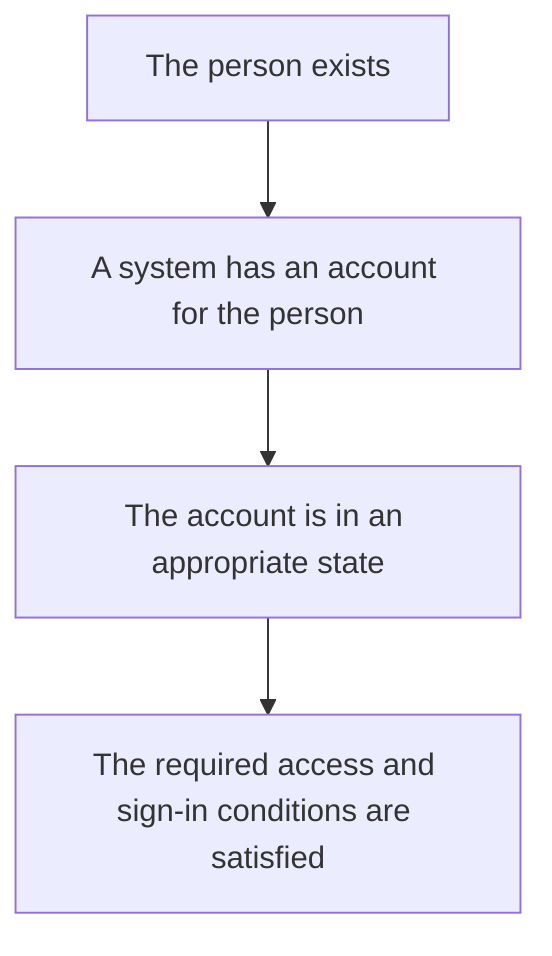
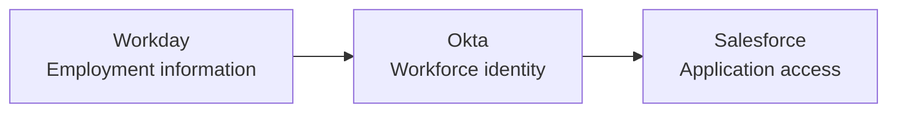
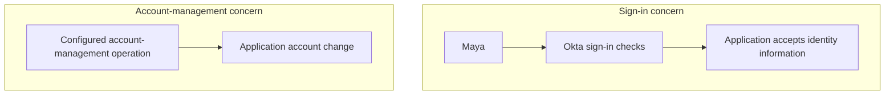
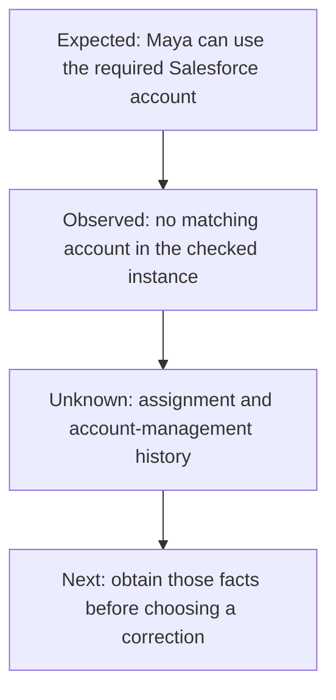

# Day 1: People, identities, and access

Maya Rao has joined the Sales team at Northbridge Services. Human Resources (**HR**), the team responsible for employee records, has recorded her employment details. Her manager expects her to start using Salesforce, where the Sales team works with customer information. At Northbridge, Okta is the identity platform that helps manage employee sign-in and access to business applications such as Salesforce.

From Maya's point of view, that sounds straightforward: she has joined the company, she has work to do, and Salesforce is the application she needs. She opens her laptop, signs in to Okta, and then reports:

> I can sign in to Okta, but I cannot use Salesforce.

It is understandable to expect a successful sign-in to mean Maya is ready to work. But her report leaves several questions open. **What does her successful Okta sign-in tell us, and what does it leave unanswered?**

Alex is Northbridge's **identity and access management (IAM)** administrator. His work includes helping the company manage who its users are and which systems they may use. To investigate Maya's report, he needs to separate five questions. Does Maya have an Okta user? Is Salesforce assigned to her? Does the intended Salesforce account exist? Can she complete Salesforce sign-in? And does she have the permissions needed for her work?

Alex cannot choose a correction yet. Separating these questions helps him decide which record to inspect next. They describe different facts to check, rather than a fixed order in which every company's systems operate. An application account, for example, might already exist before its sign-in connection is configured.

You do not need an Okta tenant or knowledge of its menus to follow the reasoning. As we follow Maya, notice which system holds each record and which question each observation answers. By the end, you should be able to explain why successful sign-in can coexist with missing application access.

## Maya is one person; the systems hold different records

Think about the work each team needs to do for Maya. HR needs her employee number, department, and manager. Active Directory (**AD**) holds a workplace account that directory-connected services can use. We will look at directories shortly; for now, think of this as another record about Maya, with its own job. Okta needs a user record it can use in its identity and access decisions. Salesforce needs an application account that represents her inside the Sales application.

Why keep records in several places? These systems support different work. Workday maintains employment information for HR. AD supports directory-related sign-in and access needs. Okta connects identity information with application assignments and sign-in. Salesforce manages the account and permissions Maya uses inside Salesforce. Keeping Maya's information in Okta does not replace the work those other systems perform.

Those records are connected, but they are not the same object. The table keeps their responsibilities separate:

| Place | What represents Maya there? | What is it for? |
|---|---|---|
| Workday | Employee record | Employment information, such as her employee number and department. |
| Active Directory | Directory account | Directory-related sign-in and access needs. |
| Okta | Okta user | Her representation in Okta for identity information and access decisions. |
| Salesforce | Salesforce user account | Her representation inside the Sales application. |

Maya is one person represented by several records. Each record belongs to a particular system and serves a particular purpose. When someone says “Maya's account,” we need to know which record they mean before we can interpret its state.

In identity and access management, an **identity** is the representation of who someone is. An **account** is a system-specific record through which that person may sign in or receive access. Some identities represent services or software rather than people; our starting examples follow employees and contractors.

An account can exist without being ready for use. It might be **disabled**, meaning the record is kept but is not enabled for ordinary sign-in. It might be waiting for activation, or it might lack permission for a particular task. Saying “the account exists” therefore does not establish that Maya can do her job. Follow the diagram from the person to the conditions for access, noticing the additional question at each step:

The arrows organize the questions; they do not promise that one successful check settles the next. Finding an account establishes its existence. Checking its state and the relevant access conditions tells us more about whether Maya can use it.

That distinction helps us choose an appropriate correction. If Maya has an Okta user but no Salesforce account, resetting her Okta password does not create the missing Salesforce account. A change should address the gap we actually found.

## What a directory does

A company needs an organized place to keep information about users. Imagine trying to make an access decision when each application has a different description of Maya's department or worker type. Before systems can use that information consistently, they need records they can read and maintain.

An organized collection of user information is a **directory**. It can also store groups, which are collections of users. Their access behavior is the subject of Day 5.

Active Directory is one such directory. Northbridge uses it for directory accounts and groups. Okta also keeps identity information in a directory layer called **Universal Directory**. For now, focus on the role they share: holding organized information that systems can use. Their different responsibilities will become clearer as we follow the course.

Think about the useful question each record helps answer:

- Who is this user?
- What is their department?
- What kind of worker are they?
- What groups are associated with them?

Imagine Alex opens Maya's Okta user record and reads her name and department. These individual details are called **attributes**. The collection of details in that record is her **profile**. Think of a form: Department is the field, Sales is the value written in it, and the completed set of fields makes up the profile. Alex can compare the department recorded here with the department in Workday before investigating how an update reached Okta.

Here is a small fictional example of information about Maya:

| Detail | Value |
|---|---|
| Name | Maya Rao |
| Employee number | NB-1042 |
| Department | Sales |
| Worker type | Employee |

Read the department and worker type together: this record describes Maya as a Sales employee. Those values can become inputs to access decisions. Later, we will follow how they affect access; today, we need to recognize where the information is recorded.

Suppose HR shows the correct Sales value in Workday. That is useful evidence about Workday. To say the same value is present in Okta or Salesforce, however, we need to inspect the relevant record there. The destination might already be correct or might contain an older value. Its maintenance could involve a configured update or an authorized manual process. First compare the records; if they differ, investigate how the information in that system gets updated.

## Why Northbridge uses Okta

Now consider the broader problem. Northbridge has several applications, each with its own accounts and access decisions. The company needs a consistent way to connect workforce identity information to application access and sign-in as people join, change responsibilities, and leave.

Okta helps Northbridge maintain identity information, assign applications, make sign-in decisions, and connect to other systems for supported account-management operations. Each responsibility answers a different part of Maya's access question.

Follow Maya's employment information. HR records her name, employee number, and department in Workday. Okta also needs information about her. Northbridge's configured connection lets employee information reach Okta without someone having to enter every detail again. That connection is an **integration**: a relationship configured for particular supported tasks. The administrator sets up the connection; Maya does not move her HR record herself.

In this flow, Workday supplies the information, so it is the **source**. Okta receives it, so it is the **target**. Later, when Okta supplies information to an application, Okta takes the source role in that different flow. These terms tell Alex where information comes from and where to check whether it arrived. A connection's existence alone does not prove that Maya's latest update reached its destination.

Read this picture from left to right. Begin with the employee information, then follow its relationship to the workforce identity and the application:

This diagram focuses on the path toward Salesforce. Northbridge also uses AD, but that relationship is not shown here.

The first arrow means that employee information can reach Okta through a configured integration. The second represents the configured relationship between Okta and the application. In Northbridge's main employee setup, Workday supplies HR information to Okta, and Okta connects onward to AD and business applications.

Pause at the second arrow. A single app integration can support sign-in, account management, or both, depending on its capabilities and configuration. These solve different problems, so Alex checks their results separately. The picture describes the relationships; Maya's records and operation results tell him what has actually happened.

Priya Shah also works with the Sales team, but she is a contractor. Her identity is maintained in Okta following approval from her **sponsor**, the employee responsible for confirming her business need at Northbridge. Maya's employee data comes from Workday; Priya's identity follows a different maintenance process.

That difference matters when choosing where to investigate or correct information. A connection used for employees does not mean every identity must come from that source. Start with the particular person and their applicable process, then follow the relevant systems.

## Signing in and having permission are different

Return to Maya signing in. Suppose she enters her sign-in details and satisfies the required checks. The system accepts that the sign-in is being performed by the expected user.

That process is **authentication**: checking who is signing in. It gives the system a basis for recognizing the user in that interaction.

Consider a separate hypothetical situation: Maya successfully enters an application, but it denies an action reserved for Finance managers. Her sign-in worked in this example. The unanswered question is whether she has permission to perform that action. This example does not resolve her original Salesforce ticket.

That decision is **authorization**: determining what the authenticated user is allowed to access or do.

| Question | Concept |
|---|---|
| Is this the expected user signing in? | Authentication |
| May this user access the application or perform this action? | Authorization |

For a familiar comparison, think of a security desk checking a person's badge and a restricted room requiring separate permission. Recognizing the person and permitting entry answer different questions. The comparison separates the ideas; in an application, we still need evidence of its actual sign-in and permission decisions.

In this hypothetical example, the application recognizes Maya but must still apply the permission required for the action. Authentication can succeed while that action is denied. A working sign-in does not grant every permission.

Authorization decisions can happen at more than one boundary. Okta can determine whether a user is assigned an application, while the application controls its own features and permissions. An assignment in Okta is not a guarantee that every action inside the application is allowed.

This is why an administrator begins by clarifying “cannot access.” Does Maya fail to sign in to Okta? Does Salesforce reject her sign-in? Or can she enter Salesforce but not use a particular feature? Each description points to a different question. A precise symptom makes the next check more useful.

## SSO helps with sign-in; provisioning manages accounts

Consider two situations. In the first, Maya needs a Salesforce account. If Northbridge has configured supported automatic account management for Salesforce, the connection can request an account change, such as creation, and Salesforce must process it. Alex checks the result in the application; a requested change is not proof of a completed change. If accounts are created through a separate process, he follows that process instead. Creating and maintaining application accounts is called **provisioning**.

In the second situation, Maya has a suitable application account and wants to open the application. Northbridge can connect its sign-in to Okta so she does not have to enter separate credentials for every application. **Credentials** are information used to establish identity during authentication, such as a password. Helping her sign in through that established relationship is **single sign-on**, usually called **SSO**. Creating the account and signing in to it solve different problems.

Consider a representative **federated sign-in**. The application trusts identity information from another system under a configured relationship. Okta authenticates Maya as required and sends the application information it can validate. The application then uses that information to complete its own sign-in process. For now, follow the responsibility of each system: Okta provides identity information, and the application must use its configured checks to accept it. We will examine the messages later.

SSO does not mean that another check will never be required. Each system can have requirements for starting or continuing a signed-in interaction; Day 2 introduces the term *session* for that interaction.

Provisioning also includes updates to an existing application account. Removing or disabling access, such as when employment ends, is commonly discussed as **deprovisioning**.

The diagram places those responsibilities in separate flows. Follow the sign-in flow with Maya, then look at the account-management flow and notice what it is trying to change:

The upper flow concerns Maya's sign-in. The lower flow changes an application account. Alex checks whether the application accepted the sign-in in the upper flow, and whether the requested account change occurred in the lower flow. SSO supports sign-in; provisioning manages accounts. They can be related because Maya may need a suitable account to use the application, but each flow has its own result to verify.

An application might have SSO configured while its accounts are created separately. An account might already exist before SSO is connected. An automatic provisioning attempt might fail even though the user can sign in to Okta. Each arrangement is a reason to ask how this particular application's accounts are managed.

Different applications can use different account-management methods. For Maya's Salesforce ticket, we first need the account and assignment facts; the connection's technical details come afterward.

## Being assigned an application is another fact to check

Knowing who Maya is does not, by itself, express which applications she should receive. Northbridge needs a way to represent that relationship. In Okta, this includes **application assignments**.

For example, an assignment connects Maya's Okta user to the particular Salesforce integration she is meant to use. Alex can inspect that relationship in Okta without assuming that Salesforce has already created her account. For Maya's ticket, whether that assignment exists is still unknown. How Northbridge manages assignments comes later; today, keep the relationship separate from account creation and successful sign-in.

Keep these statements separate:

1. Maya exists as an Okta user.
2. Maya is assigned Salesforce in Okta.
3. Maya has a Salesforce account.
4. Maya can complete Salesforce sign-in.
5. Maya has the Salesforce permissions needed for her work.

These are the five questions from our opening, now expressed as claims Alex could support with evidence. They are connected, but each needs its own check. Evidence for statement 1 does not establish statements 2 through 5, and assignment evidence alone does not settle the account or application results.

An assignment can trigger configured provisioning, but assignment itself is not proof of successful account creation. An **application tile** is the app's visible shortcut on the user's dashboard. Seeing it does not confirm that the account exists or that sign-in works. An assigned application can also have its dashboard tile hidden, so not seeing a tile does not, by itself, establish that the application is unassigned.

## Investigating Maya's ticket

Before investigating the failure, picture an illustrative successful journey. HR records an employee in Workday, and the configured connection provides the required information to Okta. The employee receives the appropriate application assignment. A supported provisioning process creates or updates the application account if configured; otherwise, the separate account-management process supplies it. The employee completes the required sign-in checks, and the application permits the actions their permissions allow.

This is one possible configured journey, not a universal sequence or a verified outcome for Maya. An account may already exist, and each operation needs its own evidence. You do not need the protocol messages or configuration menus today. You need to recognize the different responsibilities and ask whether their expected results occurred.

We can now return to Maya's report with more useful questions:

> I can sign in to Okta, but I cannot use Salesforce.

Alex collects the following information. This is a fictional training snapshot, not a captured production record.

Before reading the findings, establish how Alex identifies the right records. An **identifier** distinguishes a record, such as an employee number or application username. The approved identifier here means the value Northbridge expects to use when finding Maya's Salesforce account. For example, an employee number might identify her HR record while a username identifies her application account. Those values can be different and still refer to Maya.

He must also identify the intended **application instance**. An application can have a **production** environment used for everyday work and a separate **test** environment used to try changes. An Okta app integration instance is one particular configured connection; Alex checks which Salesforce environment that connection leads to. Searching test would not tell him whether Maya has an account in production. In the findings below, he has identified the environment he searched and the identifier he used.

| Observation | Evidence available |
|---|---|
| HR has Maya recorded as a Sales employee. | Workday record for employee NB-1042. |
| Maya has an Okta user in Active status. | Her Okta user record. |
| Maya completed the required Okta sign-in checks for this attempt. | A successful sign-in result for the identified attempt. |
| An AD account is associated with Maya. | The directory account association. |
| No Salesforce account matches Maya's approved identifier in the checked Salesforce environment. | A target-side account check. |
| Salesforce assignment in Okta has not been inspected. | No assignment evidence collected yet. |
| Provisioning configuration and results have not been inspected. | No account-management evidence collected yet. |

The first four rows establish Maya's employment, Okta user, sign-in result, and AD association. The Salesforce row identifies a gap: the check did not find a matching account under the expected identifier in that instance.

The last two rows describe missing evidence. **Not inspected** means Alex has not checked yet. **Confirmed absent** means he checked a specified place and did not find the expected item there. The scope of that check matters.

For an everyday comparison, searching one folder for a filename and finding no match does not prove the file is absent from the whole computer. Maya's account search has the same limit: no account matched the expected identifier in the checked Salesforce environment. An account might be missing, or it might exist under another identifier. Neither explanation is confirmed yet. Her assignment is a different unknown because Alex has not inspected it at all.

Pause before following Alex's next step. With assignment and account-management results still unknown, which check would you choose next, and what would its result help you distinguish? Consider why creating another account immediately could be premature.

Possible explanations include a missing assignment, an account-management process that has not completed, or an identifier mismatch involving an existing account. Each is a **hypothesis**: a possible explanation that still needs evidence. Several explanations can fit the same symptom, so the next check should help distinguish them.

Alex should inspect the expected Salesforce assignment and how Northbridge manages that application's accounts. Assignment evidence will answer a question the packet currently leaves open. The account-management approach will tell him which process and results to inspect: automatic provisioning, if configured, or the separate process responsible for creating accounts.

Those findings can change his next action. If an expected assignment is confirmed absent, he needs to investigate that gap against the access requirement. If the assignment is present, he still needs the account-management and matching evidence. Finding an existing account under a different identifier would require establishing whether it belongs to Maya before considering a new account. None of those outcomes has been supplied yet.

Follow the diagram as a reasoning sequence. Start with the intended outcome, compare it with the observed result, then use the unknowns to choose the next evidence:

The diagram's “checked instance” means the Salesforce environment inspected for the account. The final box is an evidence request, not a completed fix. Alex has made progress by narrowing the investigation, even though he cannot yet close the ticket. Resetting Maya's password because she reported an access problem would be guessing; her successful Okta sign-in already points toward the other unanswered questions for this attempt.

## Apply the distinction to Daniel

Daniel Brooks is a Finance manager. He signs in to Okta and then enters Northbridge Expense successfully. When he tries to approve an expense, the application denies the action.

Daniel has reached the application. The refusal happens when he attempts a particular action, so his reported symptom does not point back to an unproven password problem.

The supplied observations show a successful sign-in and application entry. The unanswered question concerns the approval action: what permission does it require, and does Daniel have it? Alex should follow that question to the application's permission evidence and the approved requirement.

Daniel's manager title is relevant business information, but it does not prove that the application permission has been granted correctly. Establish what he should be allowed to do before proposing a permission change. An administrator should compare the approved requirement with his actual application permissions.

Maya's next checks concern assignment, account management, and account matching. Daniel's concern the denied action and its required permission. Both users describe an "access issue," but their evidence leads Alex to different investigations. Ask where the expected outcome first differs from what was observed.

## Start with the right record

When Maya says “my account is active,” ask which account she means. The People area in the Okta Admin Console helps you inspect her Okta user. The application integration holds her assignment information. The Salesforce owner checks the Salesforce account. These views describe different records.

You do not need to memorize those locations today. Understand why an investigator might need more than one view: each can answer a different question about Maya. Start with the approved identifier, intended Okta integration, and the Salesforce environment it connects to, rather than relying on a familiar display name.

Record what each check establishes before moving to the next. If the Okta user exists but application assignment has not been checked, write exactly that. “User exists; assignment unknown” gives the next person a useful starting point without making them separate your findings from your assumptions.

Before proposing any change, agree on the intended outcome. Does Maya need to enter Salesforce, see a particular set of records, or perform an action? Those requests can require different investigations. Adding an account would be premature if the real issue is a permission on an existing account. The outcome tells us what we need to verify; the evidence tells us which correction is justified.

Carry three habits into the next lesson: name the record and the system that holds it, keep the access decisions separate, and distinguish missing evidence from a confirmed finding. Together, these habits help you explain an access problem and choose a next check for a reason.

## Tell Maya's story

Maya asks, “Why do we need to check Salesforce if my Okta sign-in worked?” Explain the separate records and access decisions in your own words, as though you were answering her.

Now consider a separate variation: the intended Salesforce account is found, but it is disabled. Explain what that finding establishes, what you would check next, and why enabling it immediately still needs an approved requirement. This variation does not change the original ticket's findings.

## Before moving on

Can you explain these without looking up a definition?

- Why can Maya have an Okta user but still be unable to use Salesforce?
- How is authentication different from authorization?
- What does SSO do, and what does provisioning do?
- Why is a correct department value in Workday not proof of the value in Salesforce?
- What is the difference between "not inspected" and "confirmed absent"?
- What additional evidence would help Alex choose a correction for Maya?

Try the [Day 1 reasoning exercises](../exercises/day-01.md), then compare your explanation with the [separate self-check answers](../self-checks/day-01.md).

For more examples, open the [Day 1 practice bank](../question-bank/day-01.md). Each question includes its own context and an expandable teaching explanation.

In [your notebook](../notebook/guide.md), record the five separate statements about Maya's user, assignment, application account, sign-in, and permissions. Add one observation and what it cannot prove.

[Day 2](day-02-requests-and-evidence.md) follows a request between systems and shows how to read evidence from individual steps without mistaking one successful result for the whole outcome.

[Course home](../index.md) · [Northbridge reference](../reference/northbridge-company.md)

[Revise Day 1](../revision/day-01.md): revisit the concepts, example, and questions without rereading the full lesson.
