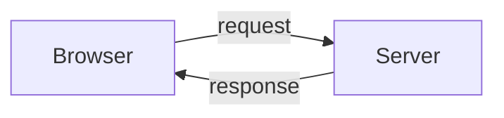
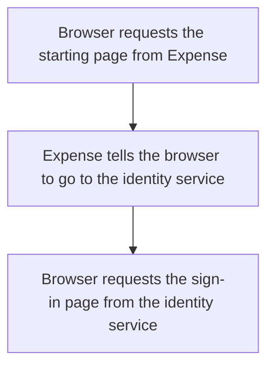
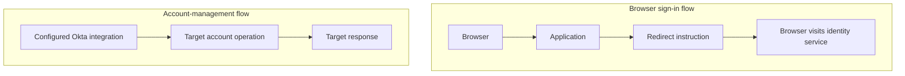

# Day 2: Following a request and reading evidence

Maya opens Northbridge Expense, the application she uses for expenses. Her browser takes her to Okta, she completes the required sign-in checks, and she returns to the application. Instead of her expense page, she sees:

> We could not accept the sign-in information. Contact support.

Alex finds an Okta **event**, a recorded occurrence such as a sign-in action, whose outcome says `SUCCESS`.

Should he tell Maya that everything worked?

The success event and the error message appear to disagree. Alex needs to ask what each one describes. This ticket concerns an Expense sign-in attempt; the Salesforce findings from Day 1 do not establish what happened here.

Before answering, remember Day 1: signing in, having an application account, and receiving application permissions are different facts. Today, we will follow the messages between systems so we can attach each result to the step it describes.

Your goal is to follow the browser from one destination to the next, then read the related event without losing track of which step it describes. By the end, you should be able to explain how one step can succeed while Maya still cannot enter Expense, and choose the evidence needed next. You can do this without a tenant or memorizing message syntax.

## Your browser asks; a server responds

When Maya opens Expense, her browser must ask the application for its starting page. The application replies with information the browser can use. Maya sees the page or message; underneath that visible result, software has exchanged messages. Opening a website, retrieving information, and submitting a form all involve this kind of exchange.

The browser's message is a **request**. The reply is a **response**. The software making the request is the **client**; here, that is the browser. The system receiving and handling the request is a **server**. Another program can also act as a client without a browser.



Follow the diagram in both directions: the browser sends the request, and the server sends the response. This describes one exchange. A page can involve many exchanges: loading it, submitting a form, and retrieving its data need not be the same request. Alex therefore avoids treating everything Maya sees on the screen as the result of one message.

**HTTP**, short for Hypertext Transfer Protocol, provides rules for these web messages. A **protocol** is an agreed set of communication rules, so the sender and receiver can understand how a message is organized. **HTTPS** is HTTP over an encrypted connection. Encryption protects the communication in transit; it does not prove that the application granted access or that its business operation succeeded.

For each message, ask three questions:

- Who sent it?
- Who received it?
- What was requested, and what did the reply report?

Those questions also apply when two systems communicate without a browser.

## Read the destination before interpreting the result

Here is a fictional address Maya opens. All addresses in this lesson use reserved example domains; they are not live services.

```text
https://expenses.northbridge.example/start?view=home
```

The address is a **URL**, the web address the browser uses. Read it in pieces: how to communicate, which host to contact, what to request there, and what extra information to send. The table separates those instructions so Alex can identify which system was asked to do what.

| Part | Meaning in this example |
|---|---|
| `https` | The scheme: how to contact the destination, here using an encrypted HTTP connection. |
| `expenses.northbridge.example` | The host name: the named destination being contacted. |
| `/start` | The path: the page or resource requested at that destination. |
| `?view=home` | Additional information in the query string: the parameter `view` has the value `home`. |

The query string is information sent with the request. Seeing a value there does not prove the server applied it or changed a stored record.

For Maya's problem, the host matters. Her browser can visit the identity service and Expense during the same sign-in journey, but they answer different requests. Before Alex interprets a successful response, he identifies the host that sent it. A successful response from the Okta sign-in page is not a successful response from Northbridge Expense.

## What the request is asking for

Maya might ask to view a page or submit information for processing. An HTTP request uses a **method** to express the kind of operation it asks for. Think of the destination as where the request goes and the method as part of what it asks that destination to do.

Two common examples are:

- **GET:** retrieve a resource, such as a page or information.
- **POST:** submit information for the server to process, such as a form or an account-management request.

The method alone does not tell you the business operation. A POST could submit sign-in information or ask an application to create an account. Read the destination and the request's purpose before deciding which flow it belongs to.

Requests and responses can also contain **headers**, named fields that describe the message, and a **body**, its content. In a reply containing a page, the page content goes in the body. A header can instead give an instruction about where the browser should go next. You do not need every header to understand the first example. One will matter for the redirect: `Location`.

## A response can send the browser elsewhere

Northbridge Expense needs Maya to use the configured sign-in connection. Rather than immediately returning her expense page, it tells her browser to visit the identity service. Maya does not have to type the second address herself; her browser can follow the instruction.

This is a [**redirect**](https://developer.mozilla.org/en-US/docs/Web/HTTP/Guides/Redirections): the response tells the browser where to go next. The browser then makes another request to that destination.

Look at this simplified training exchange. The paths are fictional explanatory routes, not documented Okta endpoints.

```http
GET /start?view=home HTTP/1.1
Host: expenses.northbridge.example
```

Connect this HTTP example to the URL we read earlier. The **Host** line is a request header identifying the destination host. The first line uses GET and supplies the path and query information; it does not repeat the full URL. Together, these lines show which resource the browser requests from which host.

The reply is:

```http
HTTP/1.1 302 Found
Location: https://identity.northbridge.example/signin
```

The `302` is a redirect status. Although its label says Found, it does not mean 'Maya's account was found' or 'sign-in worked.' Here, the `Location` header supplies the next address for the browser to request.

Read the exchange as a short conversation between systems: “The browser asks Expense for its start page. Expense replies: go to this sign-in address.” `HTTP/1.1` identifies the protocol version used in the example; it is not an account state or the outcome of authentication.

The browser follows it and requests the sign-in page from `identity.northbridge.example`, which represents Okta in this example.



Notice who makes the next request in the diagram: the browser. Expense supplied a direction; the browser follows it by contacting the identity service. The redirect has not created Maya's application account or proved that she authenticated. It has moved the browser to another part of the sign-in flow.

## A status code describes a request's result

The number at the beginning of the reply is an **HTTP status code**. It reports how the receiving server handled that particular request. Alex reads the request and reply together: the same number is less useful if he does not know what was being requested.

Start with three results from Maya's example:

| Code | What it tells us | What it does not establish |
|---|---|---|
| `200 OK` | The server successfully handled this request. | That the user authenticated or the whole business process succeeded. A sign-in page or an application-level error page can be returned with 200. |
| `302 Found` | The response directs the client to another location. | That the next destination worked or the user received access. |
| `403 Forbidden` | The server understood the request but refuses to fulfill it. | The exact reason, or necessarily that the user already authenticated correctly. |

If a browser receives `200 OK` when loading a sign-in form, the form loaded. The user might not have entered any credentials yet. The server completed the task of returning the form; Maya still has a different task ahead of her. A successful step is useful evidence, but it is not automatically the outcome she wanted.

If the application returns `403`, we need its response details and related evidence. Do not automatically translate that into "wrong password" or "missing role."

You do not need to memorize the full status-code catalog. Start by identifying which request received the response.

## Follow Maya's attempt one step at a time

First picture a successful sign-in journey: Expense directs the browser to the identity service, and Maya completes the required checks. The configured sign-in flow then brings her browser back to Expense, where the application checks the information it receives before allowing her in. We will examine the exact messages in the later sign-in lessons. This is an illustrative journey, not a statement that her present attempt succeeded.

In this connected journey, **single sign-on (SSO)** lets Expense rely on the configured identity service for sign-in information. Expense still checks what it receives. The application's **sign-in return route** is the address where the browser comes back with information for that check; reaching it is not the same as reaching Maya's expense page.

The following is a synthetic training timeline. It shows selected observations, not every network request in a real integration. For now, follow each sender, destination, and reported result.

| Step | Observation | What is established? |
|---|---|---|
| 1 | Browser requests `/start` from Northbridge Expense. | An application request was made. |
| 2 | Expense replies with `302` and an identity-service location. | The browser was directed to the sign-in service. |
| 3 | Browser requests that sign-in page; it receives `200` and a sign-in form. | The form loaded. Authentication is not established by this response. |
| 4 | Maya completes the required sign-in interaction. | The example includes a completed sign-in interaction; the response from Step 3 alone did not prove it. |
| 5 | Okta records an application SSO event with outcome `SUCCESS`. | Okta recorded success for that SSO event. |
| 6 | The browser reaches the application's sign-in return route; the application replies `403` with the rejection message. | The checked application request was refused. The message reports a sign-in-information rejection. |

Where is the first **demonstrated failure** in this packet?

It is the application refusal at Step 6. Expense returns HTTP 403 in this training example; other applications can report sign-in failures differently, so inspect their actual response rather than assume the same code. The refusal does not prove the underlying defect originated in the application. The application might reject information produced earlier in the flow. We need more evidence to identify the cause.

Alex should obtain the application's rejection details and the relevant sign-in exchange for the same attempt. Those checks help distinguish information that Expense could not accept from a problem in how Expense checked it; neither explanation is established yet. Looking only for another Okta success event would leave the rejection unexplained. Later lessons will explain which protocol fields to compare. Today, keep **where a failure is observed** separate from **what caused it**.

## Read an event as a sentence first

Okta's **System Log** records events about activity in the Okta environment. An event records a particular action and result; it does not automatically report everything that happened in a separate application.

Before looking at a record, translate it into ordinary language:

> Maya attempted SSO to Northbridge Expense, and Okta recorded that event as successful.

Here are the fields behind that sentence:

| Field | Question to ask |
|---|---|
| `eventType` | What kind of event was recorded? |
| `actor` | Which user, system, or other actor is associated with the action? |
| `target` | Which object or objects are involved? |
| `outcome.result` | What result did this event record? |

The actor is not always the person named in the original ticket. An administrator or automated process may act on someone else's account. Targets can include several objects, so inspect the relevant entries rather than assuming there is exactly one.

This synthetic excerpt contains only selected fields. The event type is documented by Okta; the people and values are fictional.

```json
{
  "eventType": "user.authentication.sso",
  "actor": {
    "displayName": "Maya Rao"
  },
  "target": [
    {
      "type": "AppInstance",
      "displayName": "Northbridge Expense"
    }
  ],
  "outcome": {
    "result": "SUCCESS"
  }
}
```

This format is **JSON**: named fields and their values. Treat it as an organized record to read. Braces group related fields into an object, and square brackets hold a list, such as the `target` list. The indentation helps you see which details belong together. You are reading the information, not writing an integration.

For example, the object under `actor` contains `displayName`, whose value is Maya Rao. The list under `target` contains one application entry in this excerpt. Read one field at a time rather than treating the whole block as code to memorize.

`outcome.result` means the `result` field inside `outcome`. The result belongs to the event named by `eventType`, with the actor and targets shown. It does not erase the later application's `403` observation.

The excerpt also lacks the identifiers and timestamp needed to independently connect it to a specific request. In the supplied timeline, the matching attempt is stated as part of the training evidence. In an incident, Alex must establish that connection using the actual records; a matching display name is not enough.

## Match the evidence to the right attempt

Suppose another record has `SUCCESS`, but its actor is Priya Shah. Or it concerns Maya opening a different application. Neither establishes the outcome of Maya's reported Expense attempt.

Check the person, application instance, relevant attempt, and available identifiers. Compare timestamps and their time zones as well: events from different attempts can have the same person and application. An **identifier** is a value used to distinguish a particular object, request, or event. Display names can repeat; object identifiers help distinguish records.

Do not assume Okta and the application automatically share one identifier. Connecting their observations may require request context, application-side references, and a consistent sequence. Detailed correlation belongs later; the habit starts now.

Here, **correlation** means establishing which records belong to the same activity. Suppose Maya tries Expense at 10:05, sees an error, and retries at 10:07. A success recorded for the second attempt would not explain the first refusal. The person and application match, but we still need to connect the records to the attempt being investigated. This is a separate example, not an extra fact about her ticket.

## A remembered sign-in is not an account

Maya returns to a website and is not immediately asked to sign in again. How can the website recognize an ongoing interaction when her browser sends a new request? It may use a previously established **session**, a way to remember an ongoing interaction across requests. For example, after Maya signs in, the site may recognize her next page request as part of that same visit instead of asking her to start again.

A [**cookie**](https://developer.mozilla.org/en-US/docs/Web/HTTP/Guides/Cookies) is a small piece of data a website can ask the browser to store and send back on matching requests. Imagine the website asks the browser to keep a value after establishing a session. On a later matching request, the browser sends that value back, helping the server associate the request with the session. A session cookie commonly supports this relationship. Not every cookie represents a sign-in session, and the cookie is not the account itself.

Keep these separate:

- The account is the system's record representing Maya.
- The session concerns an established interaction.
- The cookie is browser-held data that may help identify that interaction.

Removing a browser cookie does not delete Maya's employee record or application account. Likewise, an existing cookie does not prove that a session remains valid; the server and relevant requirements still matter.

An Okta session and an application's session are also separate. For now, recognize that evidence from one does not settle the state of the other. Their policy and lifecycle behavior comes later.

## Compare a redirect with account management

A redirect asks the browser to visit another address as part of a web flow.

A provisioning request asks a target system to perform an account-management operation, such as creating or updating an account. Recall Day 1: preparing an account and signing in are separate responsibilities. Here, a configured integration can send the account request and receive the target's reply without Maya's browser carrying either message. Maya does not need to open the sign-in page for those systems to communicate.

An **API**, short for application programming interface, is a defined way for software to ask another system for information or an operation. Think of an application offering supported requests such as 'read this account' or 'update this detail,' along with rules for sending them. Many web APIs use HTTP requests and responses. A browser opening a sign-in page and Okta sending an account-management request are both message exchanges, but they solve different problems.



Follow the upper flow from the browser to its next destination. Follow the lower flow from the configured integration to the target account operation and its response. The arrows describe different work, even though both flows involve requests and replies. A POST does not identify which flow is happening by itself. Nor does a successful browser redirect prove a provisioning operation occurred. Read who communicated, the destination, and the purpose.

<details>
<summary>Supporting reference: DNS and two additional response codes</summary>

A host name normally needs to be resolved to a network address before the connection can be made. **DNS**, the Domain Name System, helps with that lookup. If name resolution fails and no connection is established, you may have no HTTP response from the application at all. An error displayed by the browser is not automatically an application response.

Two other codes will appear in later examples: `400 Bad Request` indicates a problem with the request, and `401 Unauthorized` indicates a lack of valid authentication credentials for the requested resource. Despite its name, 401 concerns authentication; 403 is a refusal whose cause needs context.

These details are useful when a later incident concerns connectivity or an API response. Maya's present timeline can be explained using the destination and the 200, 302, and 403 observations already shown.

</details>

## Choose a search that answers the question

The System Log records events in Okta. In the Reports area, use the reported time and time zone to set a search window, then identify the person and intended application. Expand an event to inspect its actor, target, outcome, and related identifiers. A display message is a starting point, not the whole record.

If you search only for failures, you can miss the successful steps immediately before the problem. Maya's packet shows why those successes matter: they help Alex reconstruct how far this attempt progressed. If the search returns nothing, check the time window, filters, and available evidence before concluding that no attempt occurred. A search result describes what that search found. The application may also hold the only record of its own rejection.

For Maya's Expense attempt, collect the Okta event and request the application's result for the same attempt. A useful handoff says: “Okta reports this SSO event at this time; Expense returns this refusal; application validation details are still needed.” It gives the receiving owner a precise question. See [System Log search and filters](https://help.okta.com/oie/en-us/content/topics/reports/syslog-filters.htm).

Carry one habit into the next investigation: attach every result to the request or event it describes. Then connect only the records that belong to the same activity. This lets you explain both the confirmed progress and the unresolved failure without guessing a correction.

## Before moving on

Explain these in your own words:

- What is a request, and what is a response?
- Which part of the URL tells you the host being contacted?
- What does a `302` with a `Location` header ask the browser to do?
- Why can a sign-in form return `200` before authentication happens?
- What does the SSO event's `SUCCESS` prove, and what remains unknown?
- Why is a cookie different from an account?
- Why must Alex match the person, application, and attempt before using an event as evidence?

Try the [Day 2 reasoning exercises](../exercises/day-02.md), then use the [separate self-check answers](../self-checks/day-02.md).

In [your notebook](../notebook/guide.md), write Maya's request sequence. For each response or event, add a sentence beginning "This proves…" and another beginning "This does not prove…" Identify the evidence needed to investigate the application refusal.

[Day 3](day-03-profiles-and-mappings.md) follows identity values between profiles and shows how a correct source value can become a different value elsewhere.

For more examples, open the [Day 2 practice bank](../question-bank/day-02.md). Each question includes its own context and an expandable teaching explanation.

[Previous: Day 1](day-01-people-identities-access.md) · [Course home](../index.md)

[Revise Day 2](../revision/day-02.md): revisit the concepts, example, and questions without rereading the full lesson.
