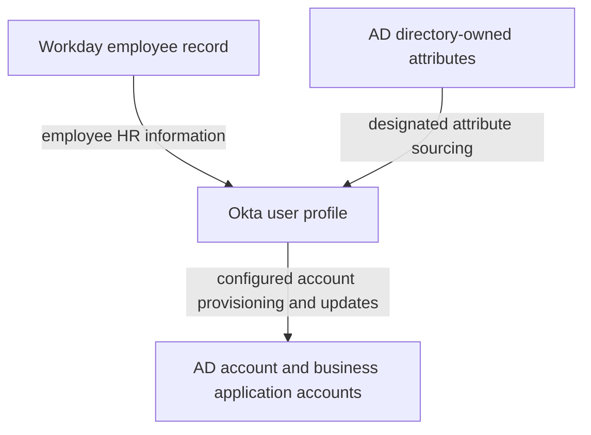
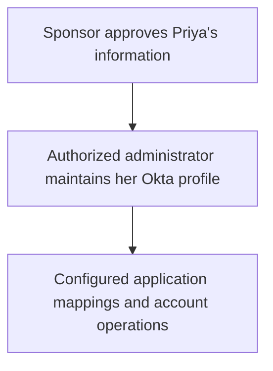
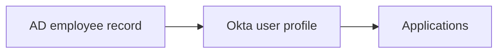

# Day 4: Sources, priority, and ownership

Maya Rao is still a Sales employee at Northbridge Services. Workday says Sales, but an AD record says Finance. Priya Shah is a Sales contractor whose department is maintained in Okta after her sponsor approves it.

Alex receives two questions:

> Can we fix Maya's department directly in Okta? And why can we maintain Priya's department there if Workday is our source?

The answer starts with which source applies to each person and which source controls the particular field. A value being visible in Okta does not make Okta its owner.

Alex can see both people's departments in Okta, but visibility alone does not tell him where an edit belongs. He needs to identify the person, find the sources linked to that person, and then check who controls the particular field.

Your goal is to explain why Maya and Priya can follow different maintenance processes in the same Okta environment, and why Maya's department and work email can have different owners. You can reason through those decisions without changing any settings or having a tenant.

## Start with authority

Day 3 followed a value through profiles and mappings. Now imagine two connected systems supply different departments for Maya. A rule that copies each value cannot, by itself, tell Alex which department the company intends to maintain. A mapping describes where a value goes and how it changes format; ownership identifies which system controls it.

A **profile source** is the system designated to control a user's profile. Older material may call this a profile master. A user has one effective profile source at a time, although individual attributes can have separately designated sources. Okta's [profile sourcing documentation](https://help.okta.com/oie/en-us/content/topics/users-groups-profiles/usgp-about-profile-sourcing.htm) makes this distinction important when several sources are connected.

Think of two questions:

- Who normally controls this person's profile?
- Does this particular attribute follow that source, or have an explicit source of its own?

Those answers can lead to different actions. An employee department correction may belong in HR, while a field explicitly controlled by AD follows its directory maintenance process. Before editing either, Alex checks the approved business value and the actual evidence. The source decision tells him where responsibility sits; it does not prove an update worked.

Here, **authority** means the responsibility to control the data; it does not mean every value in that system is correct. A wrongly recorded department can still need correction in its authoritative system. **Topology**, in the next section, means the arrangement of systems and the directions information travels between them.

## Northbridge's employee topology

For employees, Northbridge uses this arrangement:

The diagram groups AD accounts and business application accounts in one box to simplify the picture. They are separate destinations: Maya's AD account belongs to the directory, while an account in an application such as Salesforce belongs to that application. The box does not place business application accounts inside AD.

Follow the diagram one responsibility at a time. Workday supplies employee HR information to the Okta profile. Okta connects onward for supported account provisioning and updates. A separate arrow brings specifically designated directory-owned attributes from AD into Okta. AD can therefore be a destination for some account operations and a source for particular attributes. Workday remains the employee profile source in Northbridge's model.

This diagram is a statement of Northbridge's architecture. It does not mean every field moves both ways or that an account operation has succeeded. Each arrow needs its own supported configuration and evidence.

Northbridge's external profile-source order is:

| Priority | Designated source |
|---|---|
| First | Workday |
| Second | Active Directory |

**Source priority** is the configured order used when more than one designated source applies to a user. Okta supports ordering designated apps and directories on its [Profile Sources page](https://help.okta.com/oie/en-us/content/topics/users-groups-profiles/usgp-prioritize-profile-source.htm).

The list tells Alex the configured order, but it does not yet tell him which sources apply to Maya or Priya. Being first on the list does not make Workday the owner of every identity in Okta.

## First ask which sources apply to this person

Consider an employee record arriving from Workday. Bringing that record or its changes into Okta for processing is an **import**. Okta must also determine whether the incoming record represents a user it already knows; that decision is **matching**. The resulting link between an Okta user and their record in a source integration is a **source association**. These are different parts of the process: information arrives, its relationship to an Okta user is determined, and the link can be inspected. Similar names alone do not establish that the correct records are linked. Detailed matching rules come later; today, use the association evidence supplied.

**Import scope** is the set of records the integration is configured to include. Selecting employee records for import does not mean every contractor or administrative identity is included too. Scope determines which records enter processing; matching determines their proposed relationships with Okta users.

For the following fictional evidence, the associations have been checked:

| Person | Workday association | AD association | Effective profile source |
|---|---|---|---|
| Maya, employee | Present | Present | Workday |
| Daniel, employee | Present | Present | Workday |
| Priya, contractor | None | None | Okta |
| Alex's administrative identity | None | None | Okta |

Read Maya's row before the priority list: both associations are present. Of those applicable sources, Workday has higher priority, so it is her effective profile source. Then read Priya's row: neither external association is present, and her checked profile source is Okta. The same priority list therefore leads to different answers for these two people.

For an investigation, read the association evidence before applying the priority list. Do not infer an association from a department, a contractor label, or the fact that a connector is enabled.

Suppose an employee import fails. That is evidence about an operation, not proof that Workday stopped controlling the employee's profile. Likewise, an empty field does not establish a new owner. AD's second position is not evidence of automatic emergency substitution. Check the actual associations and sourcing settings before claiming ownership changed.

## Then check the particular attribute

Northbridge defines these employee ownership rules:

| Attribute | Controlling source for Maya | Intended flow |
|---|---|---|
| First name and last name | Workday | Workday to Okta |
| Department | Workday | Workday to Okta, then configured downstream mappings |
| Work email | AD, explicitly designated at attribute level | AD to Okta |

**Attribute-level sourcing** lets a field have a designated source different from the overall profile source. Okta's [attribute sourcing documentation](https://help.okta.com/oie/en-us/content/topics/users-groups-profiles/usgp-about-attribute-sourcing.htm) describes a Workday/AD/Okta example of this kind. The sourcing decision concerns the Okta user profile; an app user profile still has its own mapping and delivery considerations.

Think of Maya's profile source as the usual owner and her work-email setting as a specific exception. For department, Alex follows the Workday-led profile decision. For work email, he follows the explicit AD designation. “Workday first” cannot replace that field-level check.

The field's source setting explains the mechanism. **Inherit from profile source** means the field follows the user's effective profile source. **Inherit from Okta** designates Okta for the field. **Override profile source** designates another source for that field. These are ownership choices, not mapping formulas. See [Okta's attribute source definitions](https://help.okta.com/oie/en-us/content/topics/users-groups-profiles/usgp-define-attribute-profile-source.htm).

Apply inheritance to each person. Maya's profile source is Workday, so her department follows Workday. Priya's profile source is Okta, so her department follows approved Okta maintenance. The same inherited field setting supports both processes. It is not globally pinned to Workday for every user, and the explicit AD work-email exception remains a separate decision.

Now follow the possible write back toward AD. If AD controls email but a competing Okta-to-AD mapping writes an older email over it, the systems can undo the intended maintenance. Northbridge avoids that competing write for the AD-owned field. Arrows in both directions describe different supported responsibilities; they do not authorize both systems to overwrite the same attribute.

When asking which source wins, identify the field's sourcing configuration and the applicable source order. Do not collapse all those decisions into a single global ranking.

For Northbridge's work email, the evidence explicitly designates AD. We have not specified a rule that substitutes Workday's email when AD has no value. That behavior would need separate configuration evidence.

Bring the decisions together with four questions: which sources are linked to this person, which source controls the overall profile, whether this field inherits that source or has a different owner, and whether the observed value agrees with the expected source. Then identify the operation evidence still needed. Apply that sequence to the examples in the table:

| Question | Maya's department | Maya's work email | Priya's department |
|---|---|---|---|
| Which sources apply to this user? | Workday and AD | Workday and AD | Okta-managed; no external associations |
| Which profile source applies after priority? | Workday | Workday | Okta |
| Does this field inherit or have an explicit source? | Inherits from profile source | Explicit AD source | Inherits from profile source |
| Where does the expected value come from? | Workday | AD | Approved Okta maintenance |

That sequence identifies the expected owner. Comparing the actual values and operation results is the next step; ownership alone does not prove delivery.

## Work through the disagreement

Alex collects this synthetic packet for the same linked Maya records. Workday's Sales department is confirmed as the approved business value; no department move has occurred.

| Field | Workday record | AD record | Okta user profile |
|---|---|---|---|
| Department | Sales | Finance | Sales |
| Work email | `maya.rao@northbridge.example` | `mrao@northbridge.example` | `mrao@northbridge.example` |

The addresses are fictional. Pause before deciding which value is wrong: for each row, which source is meant to control this field, and does Okta reflect that source? Different text is not enough to establish an error.

For department, Okta reflects the designated Workday value. AD disagrees, but its lower-priority department value does not override Workday in this configuration. Alex first confirms whether Northbridge expects department to be synchronized to AD. If it does, he checks the relevant mapping, update configuration, and operation results. A difference alone does not establish a synchronization failure. Do not change the correct Okta value to Finance just to make the records agree.

For work email, Okta reflects the explicitly designated AD value. The different Workday address does not, by itself, show a defect. First compare the value against the approved email requirement and attribute ownership.

Work email is also distinct from the Okta login and an application's username. Those fields may use different values under their own mappings. The [company's identifier comparison](../reference/northbridge-company.md#keep-mayas-identifiers-separate) keeps the later examples separate from this email-ownership decision.

The department snapshots locate a disagreement, but they establish neither the intended AD maintenance process nor the history of writes. If an AD department update is expected, its operation evidence can help distinguish an update that never occurred, a rejected update, or a later write. Alex does not choose among those explanations from the current values alone.

## What if Maya's Okta department were wrong?

Consider a separate packet: Workday says Sales, Okta says Finance, and the checked ownership still says Workday controls department.

This changes the next investigation: the controlling source is correct, but the profile meant to receive its department disagrees. Alex checks whether the intended records are linked, what the incoming mapping prepares, and whether the applicable import or update occurred and succeeded. Each check distinguishes a different possible gap. A source designation expresses authority; it does not prove the latest value arrived successfully.

If HR itself had the wrong approved value, the correction should follow the HR maintenance process. If HR is correct but Okta is stale, changing HR to compensate would damage the authoritative record.

A direct Okta edit is not a durable general solution for an externally controlled attribute. Editability depends on the field's configuration, and a later source update may replace a locally changed value. Being an administrator does not settle which business system should own it.

## Why Priya can be maintained in Okta

Northbridge's contractor process is deliberately different:

Priya has no Workday association and no AD account assignment. Employee imports exclude her population. Her profile and department are Okta-managed under Northbridge's maintenance rules.

The sponsor's approval is a business decision. The sponsor is not another technical profile-source integration, and approval does not imply permission to edit Okta directly.

Follow Priya's diagram from the business decision to the administrator's maintenance, then to the configured downstream operations. Sponsor approval establishes the approved information; the authorized administrator records it in her Okta-managed profile. Application delivery still needs its own evidence. This explains why the same administrator can maintain Priya's department in Okta while routing a correction to Maya's authoritative employee data through HR.

The contractor label alone does not enforce separation. Alex must be able to establish import scope and actual associations. If an imported record is accidentally matched to Priya, her intended architecture is no longer enough to explain the observed configuration. Review the unexpected link and its effects before changing priorities or data. Detailed matching comes later.

## Field ownership and account lifecycle are separate decisions

A user's **lifecycle** includes joining, changing responsibilities, and leaving. Workday employment events drive Northbridge's configured employee account-state changes. Priya's engagement changes follow the sponsor-approved Okta maintenance process.

Giving AD ownership of Maya's email does not give it authority over her employee lifecycle. Lifecycle settings must support the intended architecture separately from attribute sourcing. Source priority alone also does not prove which accounts or sessions have been disabled. Day 12 examines those outcomes.

## Keep the AD-led variation separate

Another company might use an AD-led arrangement:

In this variation, AD is the applicable profile source and there is no applicable Workday source for the employee. AD can therefore control department through the configured incoming mapping.

That does not contradict Northbridge's Workday-led model. The source associations and ownership decisions differ. Always name the architecture before carrying conclusions from one example into another.

Do not reorder Northbridge's sources to imitate this variation as a quick fix for one stale field. Changing priority is an ownership decision that may affect many associated users.

## Profile ownership does not identify the password validator

Maya can have a Workday-sourced profile while AD validates her password on Northbridge's configured AD password sign-in path. The **Okta AD agent** is software running in the company's environment that connects Okta to AD for supported operations.

Those facts answer separate questions:

| Question | Northbridge answer for Maya |
|---|---|
| Who controls the overall employee profile? | Workday |
| Who controls work email? | AD, through the explicit attribute source |
| How does department become an application's code? | The relevant mapping and transformation |
| Who checks the password on the AD password path? | AD, reached through Okta's AD agent |

When Maya uses the stated password path, AD checks her credential through the agent. That answers a sign-in question, while Workday's ownership answers a data-maintenance question. The password validator does not thereby own her HR department. Likewise, a successful profile update does not establish that the password path is healthy. You only need to keep these responsibilities separate today; Day 6 follows that path in detail.

## Investigate a value that comes back

Imagine Alex changes an employee's department in Okta and later sees the old value again. Before repeating the edit, inspect the user's source associations, the field's owner, and the intervening source update. A later authoritative write is a possible explanation, but the timing and event evidence must establish it.

Use the user's profile and the integration's sourcing and mapping settings together. The user view shows the observed value; the configuration explains which source is meant to supply it. Neither view alone reconstructs every write.

If Workday contains an incorrect approved employee record, the HR owner handles that correction. If Workday is correct but the incoming mapping is wrong, investigate the mapping instead. Reordering sources for one person's discrepancy can change ownership for other associated users. Priya's approved Okta-managed maintenance follows her own source model, not a workaround for the employee model.

Carry the sequence into the next ticket: identify the linked sources for this person, determine the effective profile source, check the particular field's owner, then compare values and operation results. This prevents a configuration decision from being mistaken for proof that the expected data arrived.

## Tell Maya's and Priya's stories

Explain why Maya's Workday association and source order matter before interpreting her department. Then explain why AD can supply her work email without becoming her overall profile source.

For Priya, name the missing external associations, the employee import exclusion, and the authorized Okta maintenance process. “She is a contractor” is a description, not the complete mechanism.

Finally, add Day 3's delivery distinction: even a correctly owned and mapped value must still be verified in its destination.

## Before moving on

Can you explain:

- Why source priority must be read alongside a user's associations?
- How one profile source can coexist with a different source for a particular attribute?
- Why AD's department does not win for Maya in the supplied packet?
- Why Priya's profile can be maintained in Okta?
- Why a missing value does not establish automatic fallback?
- Why a mapping and a password validator are different from a profile source?
- What evidence distinguishes incorrect ownership from an update that has not reached its destination?

Try the [Day 4 exercises](../exercises/day-04.md), then use the [self-check answers](../self-checks/day-04.md).

In [your notebook](../notebook/guide.md), annotate the data flow with the person, source associations, effective profile source, field owner, and mapping direction. Leave operation results marked unknown when no evidence supplies them.

[Day 5](day-05-groups-and-assignments.md) connects these identity attributes to groups and application assignments.

For more examples, open the [Day 4 practice bank](../question-bank/day-04.md). Each question includes its own context and an expandable teaching explanation.

[Previous: Day 3](day-03-profiles-and-mappings.md) · [Course home](../index.md)

[Revise Day 4](../revision/day-04.md): revisit the concepts, example, and questions without rereading the full lesson.
