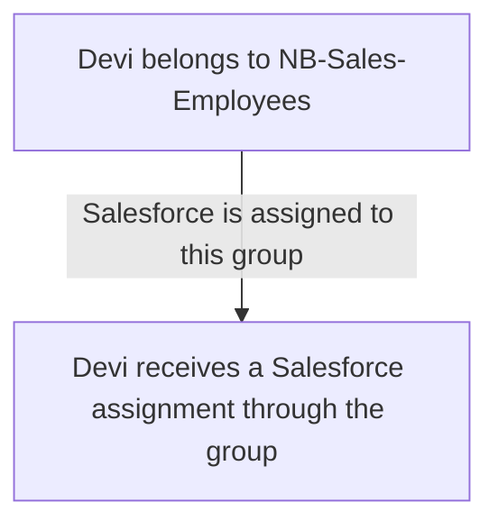
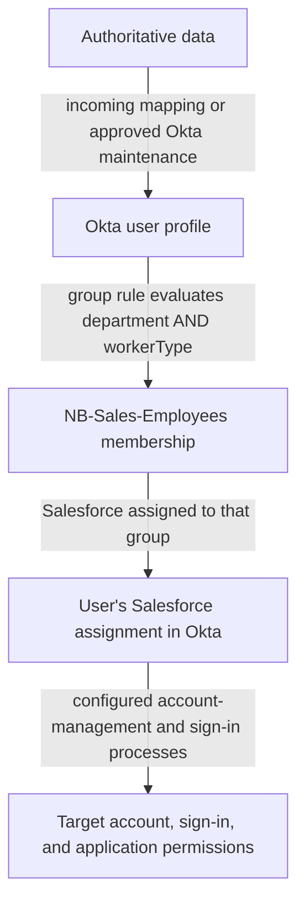

# Day 5: Groups, rules, and application assignments

Devi and Priya both work with Sales at Northbridge Services. Devi is an employee; Priya is a contractor. Their manager asks:

> They have the same department. Why does Devi receive Salesforce automatically while Priya does not?

Northbridge's requirement is more specific than “give Sales access.” Sales employees receive Salesforce through the normal access process. Sales contractors do not receive it automatically; a separately approved exception may be considered.

Today, follow how that requirement becomes a group membership and an application assignment. Remember Day 4: Devi's employee information comes from Workday, while Priya's profile is maintained in Okta through an approved process.

Alex needs to turn the approved requirement into relationships Okta can manage, then verify what happened. Follow three questions: does this person meet the condition, are they actually in the group, and does that group provide their application assignment? Each question has its own evidence. You can follow the examples without a tenant or writing expression code.

## Manage a shared need through a group

Imagine Alex needs to provide the same application to several Sales employees. He could assign Salesforce to each person separately, but he would have to repeat and maintain the same decision for each assignment. A **group** is a collection of users managed together. It gives Northbridge a place to represent that shared need while still checking who belongs there.

Instead, Northbridge uses an Okta-managed group named `NB-Sales-Employees`. Its intended members are employees in Sales. Salesforce is assigned to that group.

There are two distinct relationships:



**Membership** means a user belongs to the group. **Group-based application assignment** means members receive an application assignment through that group's connection to the application.

Read the diagram as two checks. First, open the group and check whether Devi is a member. Then check whether Salesforce is actually assigned to that group. Devi could belong to the group while the application connection is missing, or Salesforce could be assigned to a group she does not belong to. The name `NB-Sales-Employees` is a label, not an instruction. Naming a group does not define its members or connect it to Salesforce. Both relationships need configuration and evidence.

## A rule decides membership; an assignment connects the application

Instead of asking Alex to decide every membership individually, Northbridge can define the qualifying condition and let Okta evaluate it. A **group rule** uses that condition to manage membership in its designated group. In this example, it reads the department and workforce classification represented in the central Okta user profile.

Northbridge defines a custom text attribute, `workerType`, whose approved values here are `Employee` and `Contractor`. It describes the person's workforce classification. It is not their account status or the name of an Okta profile schema type.

Workday supplies that classification for employees. Priya's value is maintained through her sponsor-approved Okta process. Northbridge does not let users choose their own classification to obtain access.

The intended rule is:

```text
If department is Sales
AND workerType is Employee
then include the user in NB-Sales-Employees.
```

This is plain-language logic, not expression code. **AND** requires both conditions to be true. A **Boolean** result is simply true or false: here, it answers 'Does this profile meet the condition?' It is not an account status or proof that the membership action completed.

If the condition is true and the configured rule processes the user without an applicable exclusion, its membership action can place the user in the designated group. The rule is not itself a command to create a Salesforce account. The separate assignment of Salesforce to the group gives that membership its application-access purpose.



Read the diagram from the approved data toward the application outcome. The profile supplies the inputs, the rule determines qualifying membership, and the group's application connection supplies an assignment. Account management and sign-in still have work of their own. This is a conceptual dependency flow, not a guarantee that all steps complete immediately or successfully. The last box contains three separate outcomes to verify: the target account, sign-in, and application permissions. Devi can have a Salesforce assignment while any of those outcomes still needs investigation.

## Predict who matches

All three users below are Active in Okta. The example rule is active, has no individual exclusions for them, and has processed the supplied profiles. There are no other membership mechanisms for this example group.

There are two different uses of *active* here. **Active user** describes the account's state. **Active rule** means the rule is enabled to operate. 'Devi's account is Active' does not answer 'Has this rule added Devi to the group?' An **exclusion** is a specific exception preventing the rule from adding a user, even when their profile matches.

Account state also affects rule processing. For this rule, which does not specify a user-status condition, Okta includes active users. With the account state, rule state, processing and lack of exclusions established, we can compare the two profile conditions in the table. In an investigation, check those facts rather than assume them.

Before reading the explanation, predict the result for each person:

| Person | Okta department | Okta workerType |
|---|---|---|
| Devi | Sales | Employee |
| Priya | Sales | Contractor |
| Daniel | Finance | Employee |

For Devi, both answers are yes: she is in Sales and is an employee. Priya shares her department but has a different workforce classification. Daniel is an employee but belongs to Finance. Only Devi meets both conditions. The different outcomes follow the approved requirement; sharing one detail is not enough.

Changing AND to OR would produce a different business rule: a person could qualify by being in Sales or by being an employee. That would include Priya and Daniel in this table. It would not implement Northbridge's employee-only Sales requirement.

With AND, ask both questions and require two “yes” answers. With OR, one “yes” is sufficient; a person who meets both conditions also qualifies. The **population** affected by a rule means the set of users it would include.

A missing or unfamiliar `workerType` does not establish Employee status. Investigate its source and mapping instead of treating “not known to be a contractor” as “confirmed employee.”

## Read the current profile, not just the source record

For this attribute-based rule, the inputs are department and workerType in the central Okta user profile. Evaluating that condition does not ask Workday for a fresh department. The external values must first reach the Okta fields that the rule actually reads.

Suppose Workday correctly says Sales, but Devi's Okta profile says Finance. The rule can correctly evaluate the supplied Okta value and still produce an outcome that conflicts with the business requirement.

Alex therefore compares the approved source value with the actual rule input before broadening the condition. Including Finance to compensate for Devi's stale profile would change the access requirement for other Finance users too. Day 3's mapping and delivery investigation may be needed before membership can be correct.

Also keep the profile layers distinct. A Salesforce app user profile value or a department displayed inside Salesforce is not the same evidence as the central Okta user attribute this rule evaluates.

## A matching condition is not observed membership

An administrator can save a rule without activating it. A valid condition alone therefore does not establish that the rule has operated. A rule can also have explicitly excluded users.

When a matching user is absent, check:

- The current Okta attributes and account state.
- Whether the rule is active and targets the intended group.
- Whether an exclusion applies.
- Evidence of processing and actual membership.

A matching condition answers what should qualify for this input. Rule state and exclusions explain whether the intended mechanism can act for this person. Processing and membership evidence establish what actually happened. A rule preview or your own prediction does not replace the last check.

Here is a separate synthetic incident:

| Observation | Evidence |
|---|---|
| Devi's Okta profile | Sales / Employee; Active account. |
| Rule condition | Sales AND Employee; targets NB-Sales-Employees. |
| Rule state | Inactive; never activated. |
| Existing group membership | Devi absent; no other membership mechanism configured. |
| Group-to-application relationship | Salesforce assigned to NB-Sales-Employees. |

The condition matches, and the group already has its Salesforce connection. The gap is earlier: this rule has never been activated, so the intended automatic membership mechanism has not operated. The packet demonstrates that configuration gap, not a defect in Devi's HR department.

Alex can propose activating the approved rule after reviewing its full affected population and exclusions. Verification would check actual membership and the resulting Salesforce assignment, followed separately by the required account and sign-in evidence.

Do not use a manual removal as an assumed neutral test of a rule. When an administrator manually removes a rule-managed user from a group, Okta automatically adds that person to the rule's exclusion list. See [group-rule exclusions](https://help.okta.com/oie/en-us/content/topics/users-groups-profiles/usgp-create-group-rules.htm). That exclusion then matters when investigating why the person is absent.

## Follow a successful assignment as far as the evidence goes

Return to the normal scenario. This synthetic follow-up confirms the rule is active and processed the listed profiles:

| Person | NB-Sales-Employees membership | Salesforce assignment |
|---|---|---|
| Devi | Present through the rule | Present through NB-Sales-Employees |
| Priya | Absent | Absent; no other assignment path in this snapshot |
| Daniel | Absent | Absent; no other assignment path in this snapshot |

Read each row as two results. Devi is present through the rule, and her Salesforce assignment comes through the group. Priya and Daniel are absent, with other assignment paths explicitly absent in this snapshot. Devi's automatic assignment is demonstrated; Priya's lack of automatic assignment is expected under the stated requirement, rather than evidence of a malfunction.

The packet does not provide Salesforce account state, a provisioning result, a completed Salesforce sign-in, or application permissions. Those are still separate facts. An assignment may start a configured account-management operation; it is not a receipt showing that the target accepted it.

## An individual assignment is a separate path

A **direct assignment** assigns an application to a person individually. It can represent an approved exception, but its presence alone does not prove approval.

Consider a separate snapshot: Priya remains outside `NB-Sales-Employees`, but her Salesforce assignment is recorded as individual. No approval record is supplied.

Trace the relationship providing this assignment: it connects Priya individually to Salesforce instead of passing through the Sales employee group. Her group-rule result can remain correct while this other path exists. The unresolved question is whether that individual path has the required business approval, not whether the employee rule should be changed to include contractors.

Ask for the requirement, approval, responsible owner, and review or removal condition for the individual assignment. Do not change Priya's worker type to Employee just to make her fit the normal rule. Do not declare the exception authorized or unauthorized from missing approval evidence alone.

The phrase **assignment source** answers 'Which relationship gives this user the application assignment?' It might be a group or an individual assignment. **Profile source** answers a different question: 'Which system controls this user's profile?' Seeing Individual beside Priya's Salesforce assignment does not mean the owner of her profile changed.

## Removing one path does not settle every path

Imagine a future variation in which Devi's approved department changes to Finance. This is a prediction, not a change to her current Sales story.

Once the new value reaches her Okta profile and the active rule processes it, she no longer meets the Sales condition. In the simple rule-managed group described above, her membership should be removed.

Then investigate application assignment separately. Another assigned group or a separately maintained individual assignment can still provide a path. Even confirmed removal of the final Okta assignment does not, by itself, prove the target account's state or the end of an existing application session.

Ask which relationship ended and which ones remain. For example, if the Sales group no longer includes Devi but a second group still assigns Salesforce to her, the second path remains. Inspect that relationship rather than treating the first removal as a result for every path. Existing application sessions are another outcome to check. Use evidence in this order: updated profile, processed rule/membership result, remaining assignment paths, then relevant target outcomes. Day 12 develops the full department-move case.

## Group membership has an owner too

Not every group visible in Okta is managed by an Okta rule. Membership may come from an external directory or from authorized manual administration.

For `NB-Sales-Employees`, Northbridge deliberately uses an Okta-managed group and the stated rule. An AD-sourced group has a different maintenance path. Before proposing a membership change, identify what controls that particular group.

The name alone does not establish the owner. Keep two locations separate as well: this group is managed in Okta; a group stored inside a target application is another object. Membership in an Okta group does not mean a same-named group exists in the application.

**Group Push** is a separate capability for creating or maintaining groups and memberships in supported target applications. Assigning Salesforce to a group answers who receives the application assignment. It does not automatically create that group inside Salesforce. Where Group Push is used, Okta requires [separate groups for application assignment and Group Push](https://help.okta.com/oie/en-us/Content/Topics/users-groups-profiles/app-assignments-group-push.htm); this lesson does not assume Northbridge's Salesforce integration has Group Push configured. For now, be able to explain which relationship each capability manages; you do not need to memorize the Group Push configuration procedure.

## Follow a missing application from the user to the assignment

Start with the intended application instance and the user's assignment list. Then inspect the group and its membership mechanism. The Groups area helps answer who is actually a member; the application integration's assignments show whether that group provides this application.

Consider this separate observation: Devi has Sales and Employee in her Okta profile, the rule is enabled, but the expected group membership is absent. The condition appears to match, yet membership is not established. Exclusion and processing checks help distinguish a deliberate exception from a membership operation that needs further investigation; the packet does not establish either explanation. A direct assignment may make a tile appear while leaving the normal membership problem unresolved.

If an urgent exception is approved, record its owner and removal condition separately. After correcting the normal path, review whether the exception is still needed. Verify membership and assignment first, then check the target account and intended application use. A visible tile is a useful observation, not the complete acceptance test.

Keep the business requirement, the rule's input, and the observed relationships together. A correct rule cannot compensate for unverified data, and a confirmed assignment does not replace the application checks. At each boundary, explain what the evidence establishes before choosing a correction.

## Tell the access story

Explain Devi's flow from Workday-owned attributes to the Okta profile, the two-condition rule, group membership, and Salesforce assignment. Name the point where the packet stops proving the outcome.

Then explain Priya's two cases: no assignment under the normal rule, and an individual assignment needing separate approval evidence. A group rule determines membership; it is not a universal instruction to deny every nonmember access by every other path.

## Before moving on

Can you explain:

- Why a group name does not determine membership or assignments?
- Why Devi matches while Priya and Daniel do not?
- Which profile the example rule reads?
- Why condition, rule state, membership, and assignment are separate checks?
- How an individual assignment changes the investigation?
- Why group removal does not prove all application access has ended?
- How application assignment differs from Group Push?

Try the [Day 5 exercises](../exercises/day-05.md) and then read the [self-check answers](../self-checks/day-05.md). Next, attempt the [foundation checkpoint](../assessments/foundation.md), which combines Days 1 to 5.

In [your notebook](../notebook/guide.md), extend the ownership flow with the rule condition, membership mechanism, assignment path, and the evidence needed beyond assignment.

[Day 6](day-06-active-directory.md) separates AD imports from AD password validation.

For more examples, open the [Day 5 practice bank](../question-bank/day-05.md). Each question includes its own context and an expandable teaching explanation.

[Previous: Day 4](day-04-sources-and-ownership.md) · [Course home](../index.md)

[Revise Day 5](../revision/day-05.md): revisit the concepts, example, and questions without rereading the full lesson.
