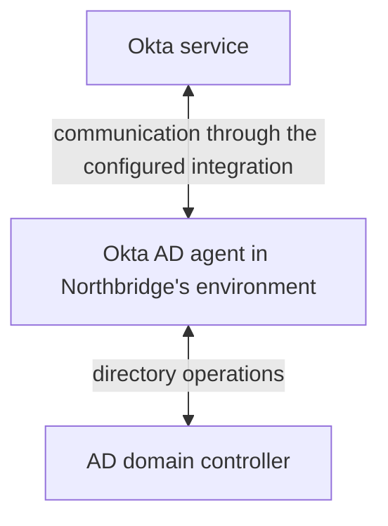
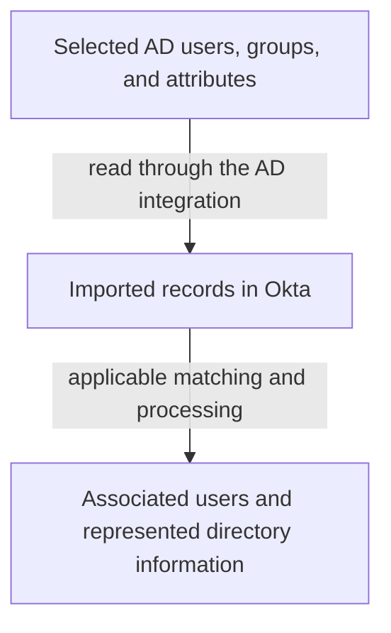
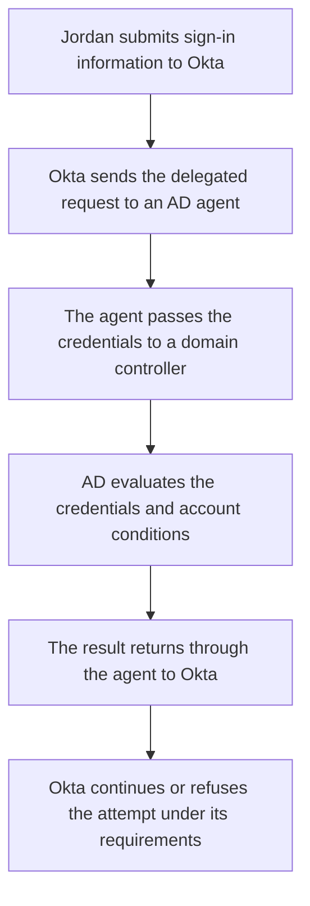
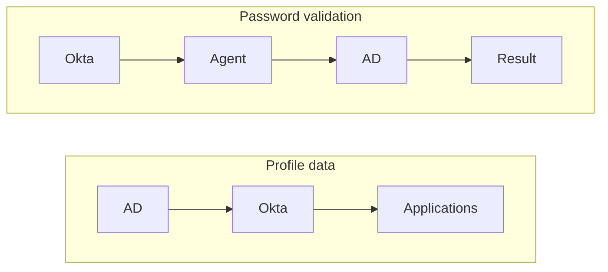

# Day 6: AD imports and password validation

Jordan Lee is currently employed at Northbridge Services. An Active Directory (**AD**) import completed successfully, and Alex confirmed that Jordan's directory record is linked to the correct Okta user.

Jordan now reports:

> My directory account is in Okta, but I cannot sign in with my AD password.

When Jordan says his directory account is in Okta, he means Okta holds information associated with his AD account. The directory account itself remains in AD. The successful record import does not establish that his AD password was copied into Okta or tested.

From Jordan's point of view, this sounds contradictory. If Okta can see his directory account, why can he not use its password? Alex needs to find out what the successful import actually did, then follow the failed sign-in on its own path. Reading an account record and checking a submitted password ask AD to do different work.

By the end of this lesson, you should be able to explain that difference to Jordan and choose the next useful check. You will also distinguish an unanswered password request from one that AD explicitly rejects. You can reason through both paths without installing an agent or using a live directory.

## Locate the directory, the server, and the agent

Start with the place that holds Jordan's directory account. Northbridge uses **Active Directory Domain Services**, often shortened here to AD, for its employee directory. It holds objects such as users, groups, and computers. An object is a directory record representing one of those things. Jordan's user object contains information about his directory account; a group represents a collection used for access or administration. The directory account is one representation of Jordan, alongside the Workday and Okta records you have already learned to distinguish.

An AD **domain** is a managed area of the directory with its own administration boundary. It contains objects such as Jordan's user account. A **domain controller**, or **DC**, is a server running the directory service for that domain. It can respond to directory queries and validate domain credentials. **Credentials** are the information used to prove identity; on this password path, they include the submitted account name and password. A domain can have more than one domain controller.

Administrators also need to organize the directory. An **organizational unit**, or **OU**, is a container inside a domain used to organize objects and let designated administrators manage that part of the directory. Think of Jordan's record stored under an employee OU: that is its directory location. A group has a separate list of members, like the membership relationship you inspected on Day 5. Placing a user inside an OU does not make that user a member of a same-named group.

The **Okta AD agent** is separate software in the company's environment. It connects Okta with AD for supported operations. It is neither the AD directory database nor the domain controller itself. It can run on a separate server.

Read the diagram as a route between components. Okta communicates with the agent, and the agent performs directory operations with a domain controller inside Northbridge's environment. The agent connects the two systems; the DC runs the directory service and can evaluate the domain credentials. Keeping those jobs separate will help you locate Jordan's failure.

The arrows show information moving in both directions, but that is different from who starts the connection. The agent initiates **outbound** communication from Northbridge's environment toward Okta. It receives work and returns results through that path. Okta does not need a new **inbound** connection from outside through the company's firewall to the agent. A firewall controls which network traffic is allowed. See [Okta's AD integration FAQ](https://help.okta.com/oie/en-us/Content/Topics/Directory/Directory_FAQ_Okta_and_AD_Groups.htm).

The agent also needs a separate connection to the relevant domain controller inside the company's environment. Receiving a request from Okta does not show that this second connection worked.

The diagram does not require exposing a domain controller directly to the internet.

## Northbridge is still HR-led

Workday controls Jordan's employee profile. Okta maintains his workforce identity and connects to his AD account. AD supplies specifically designated directory-owned values and validates his password when the AD password path is used.

These responsibilities do not conflict:

| Question | Northbridge's answer |
|---|---|
| Who controls Jordan's employee department? | Workday, through the inherited profile-source decision. |
| Where is his directory account? | AD, linked to his Okta identity. |
| Who validates his password on the configured AD password path? | AD, through the agent. |
| Who makes the remaining Okta sign-in decisions? | Okta, using the applicable requirements and context. |

Notice that the table asks a different question in each row. Workday can determine Jordan's department while AD determines whether the submitted directory credentials are acceptable. Neither responsibility replaces the other. If his password attempt fails, changing which source controls his department would address a different decision. Recall Day 4: password validation and attribute ownership answer different questions.

The import direction also fits this architecture. Reading information back from an existing AD account does not make AD the owner of every employee attribute. The configured source and mapping decisions still govern which values control the Okta profile.

Priya's Okta-managed contractor identity has no AD assignment in this architecture. Do not assume that her sign-in uses Jordan's AD path merely because both people use Okta.

## What an import establishes

Alex first checks the operation that already succeeded. An **import** brings directory records and changes into Okta for processing. It asks for directory information so Okta can represent and process the selected records. The relevant flow is:

Import scope matters. The integration selects which user and group OUs to include. That selection answers 'Which parts of the directory are we reading?' A successful import of those selected records does not mean every object in AD was included. See [AD import settings](https://help.okta.com/oie/en-us/content/topics/directory/ad-agent-configure-import.htm).

Imagine the employee user OU is included, but a separate group OU is not. The import might supply Jordan's user record without supplying a group the investigator expected. That missing group tells you something about the imported results; it does not yet tell you whether the group exists in AD. Compare the group's actual directory location with the selected group OUs and the import result. This check separates an object outside the chosen scope from one that was expected to be read but was not processed as expected.

Matching and confirmation matter too. Discovering a record is not the same as establishing the correct identity association. For Jordan's incident, the packet explicitly supplies that association; Day 11 examines how to reason about uncertain matches.

Now return to Jordan's claim. The import found and processed his selected directory information, and Alex separately confirmed the correct association. Those are useful facts. Neither is a password-validation result. Importing profile information does not demonstrate that Jordan entered a valid password, that AD accepted a password-validation request, or that a later sign-in path remained available. A result belongs to the operation that produced it.

It also does not turn every imported AD attribute into the controlling value for an HR-led user. Source and mapping settings still apply.

## Follow delegated authentication

Jordan now enters his directory sign-in information at Okta. For this configured path, the question is whether AD accepts those submitted credentials. Okta asks AD to perform that check through the agent. When a system asks another system to validate a user's credentials, it is **delegating authentication**. Northbridge uses that arrangement for Jordan's AD password path.

The following is a simplified logical flow:

Follow the request to AD, then follow the result back. Okta's [delegated authentication reference](https://help.okta.com/oie/en-us/Content/Topics/Directory/directory_ad_delegated_authentication.htm) describes this agent-to-domain-controller path. The request must reach the agent and the DC before there can be a returned AD validation result. Okta then uses that result within the applicable sign-in process. An arrow in this simplified diagram describes the next logical step; the incident evidence tells you which steps actually occurred.

A successful password result is one sign-in step. Additional authentication or policy requirements may remain, and application assignment and application-side acceptance are still separate. AD accepting Jordan's password is therefore a narrower conclusion than Jordan successfully opening Salesforce. Not every sign-in method uses this password path.

The incident evidence should identify the affected user, the directory association, the relevant attempt, and the agent/DC path involved. A successful password event for another person does not resolve Jordan's attempt.

## Three operations that should not be confused

| Operation | Main question | What success does not establish |
|---|---|---|
| Directory import | Could the configured operation read and process the selected directory data? | That a user's password was accepted. |
| Delegated password authentication | Did AD accept the credentials for this attempt through the agent? | That every later requirement or application action succeeded. |
| Password synchronization | Did a configured process propagate a password change to a supported destination? | That a later authentication attempt succeeded. |

Read each row as a different request: 'Read these directory records,' 'Check the credentials submitted for this sign-in,' or 'Carry this password change to the supported destination.' Those are import, delegated authentication and password synchronization respectively. Password synchronization transfers a change through its supported, configured process. A password-validation request is not itself evidence that a password change was copied anywhere. A deployment may use both capabilities for different purposes, but each requires its own configuration and result.

For a separate hypothetical example, suppose Jordan changes his password in AD. A configured password-synchronization process can propagate that change to a supported destination. That process transfers a change; the delegated request in Jordan's incident asks AD to validate the password he submitted. The incident supplies no password-change or synchronization event.

Okta documents a separate **AD Password Sync Agent** for relevant synchronization scenarios. Do not treat its name as another name for the ordinary AD agent. The required components and direction depend on the synchronization use case. Northbridge's incident uses delegated authentication; a successful import is not evidence of password synchronization.

If a colleague says that Jordan's password is synchronized, ask which password operation, in which direction, and for which destination. That gives you something you can inspect. A general statement that passwords are integrated leaves those decisions unanswered. At this stage, you need to distinguish the operations and components; you do not need to memorize installation procedures for every synchronization use case.

## Investigate Jordan's failed attempt

The following synthetic evidence is a plain-language investigation summary, not literal Okta or Windows log output. The investigator has correlated the authentication observations to the same attempt, labelled J-1. Earlier import I-1 is a separate operation.

| Evidence | Observation |
|---|---|
| Approved employment and Okta state | Jordan is employed; his Okta account is Active. |
| Account association | His expected AD account is linked to the checked Okta user. |
| Earlier import I-1 | Completed; Jordan's selected directory data was processed. |
| Authentication configuration | AD delegated password authentication applies to this attempt. |
| Agent observation for J-1 | The handling agent received the delegated request from Okta. |
| Agent-to-DC observation for J-1 | The connection attempt to the selected DC timed out before a credential-validation response was obtained. |
| Returned AD credential result | No acceptance or rejection result was obtained for J-1. |
| User experience | Jordan could not complete this sign-in attempt. |

Before reading on, locate the first demonstrated failure. Did AD reject Jordan's password?

Start with the two observations for J-1. The handling agent received the delegated request from Okta. Its connection attempt to the selected DC then timed out before it obtained a credential-validation response. That is the first demonstrated failure in the supplied path.

The packet does not show AD rejecting Jordan's password. It does not establish that the password was correct either: no credential result was obtained. Both conclusions would require an answer that this attempt did not supply.

A **timeout** means the operation did not obtain the expected result within its allowed wait. Compare “I did not receive an answer” with “I received an answer saying no.” They lead to different investigations even when Jordan sees a sign-in failure in both cases.

Keep the time and operation labels beside your conclusions. I-1 shows that the earlier import completed; J-1 describes the later authentication attempt. The successful earlier operation cannot fill in a missing result for the later one. Likewise, receiving Okta's request establishes one part of the communication path, while the timed-out DC connection identifies the part that still needs investigation.

Alex should request evidence for the selected agent and DC at the time of J-1. Can the agent look up the intended DC's network address? Can it establish the required connection? Is the directory service available to handle the request? These are name resolution, reachability and service-availability questions.

**Name resolution**, introduced as DNS on Day 2, is the lookup that connects a host name with a network address. A failed lookup and a timed-out connection are different observations. Asking for a lookup result does not mean Alex has already found a DNS failure.

A problem with the network route, a traffic control such as a firewall rule, or an unavailable service could help explain the timeout. The packet does not choose among them. The next check should help distinguish those explanations on this agent/DC path at the time of J-1. Resetting Jordan's password would change a credential while leaving the demonstrated connectivity failure unexplained. Alex needs evidence about the failed connection before choosing its correction.

## Contrast a credential rejection

In a separate attempt, J-2, suppose the handling agent reaches the DC and receives an explicit credential-validation rejection.

Pause before choosing the same next check as for J-1. In J-2, AD has supplied an answer: it rejected credential validation. The path obtained a response for this attempt. The unanswered question now concerns the rejected identity or credentials and relevant account conditions. Check the detailed directory result and the actual username/account involved. A result from J-2 does not retroactively supply the missing answer for J-1.

Do not translate every rejection into “the user mistyped the password.” A generic rejection may not distinguish an incorrect identifier, a password issue, or an account restriction. Ask for the detail that separates them before choosing a correction.

The identifier deserves attention as well as the password. An AD sign-in name can differ from a work email address. A **user principal name**, or **UPN**, is a directory sign-in name often written in an email-like form. Its appearance does not prove it is the person's mailbox address. Compare the configured identifier with the intended account, just as you compared identifiers across systems in earlier lessons. This packet does not supply a mismatch; it gives you a reason to check one rather than assume identical strings.

## Know what a successful follow-up proves

Here is a synthetic follow-up to J-1, with new evidence:

- The network team identifies and corrects a route preventing the handling agent from reaching the selected DC.
- A new attempt, J-3, is correlated across the relevant records.
- The agent reaches the DC, and AD returns an accepted credential result for Jordan.
- Evidence of the remaining Okta checks and application entry is not supplied.

Read the follow-up in two parts. The network team has now established a route problem and corrected it. The new, correlated attempt J-3 then supplies the credential result that was missing in J-1: AD accepts Jordan's credentials. Together, those observations support recovery of the checked connection and successful password validation in J-3.

The remaining Okta checks and application entry are still unverified. Alex can report the recovered password-validation step and explain what remains to be checked. The confirmed routing finding belongs to this follow-up; it was only a possible explanation in the original packet.

This is how an investigation progresses: keep the first conclusion within the initial evidence, then update it when additional evidence establishes the cause and recovery.

## Compare the AD-led variation

In a separately labelled AD-led company, AD may control the employee profile as well as validate the password:

Compare the two halves of the diagram. The upper path carries profile data from AD toward Okta and applications. The lower path sends a password-validation request toward AD and receives a result. AD has responsibilities in both paths at this separate company, but the operations still ask different questions.

Northbridge keeps Workday at the start of its employee profile flow. Import and authentication remain distinct in both architectures. Neither a source-priority decision nor a successful import replaces authentication evidence.

## Hand the directory team a specific question

For J-1, identify the configured AD integration, the agent involved, the selected domain controller, and the time of the failed request. The directory integration's status and agent information help locate the path. The directory and network owners may need to provide evidence that is unavailable in Okta.

Alex also needs to know how widely the problem is occurring. Are several users failing through the same agent, or is Jordan the only affected person in the checked period? A shared failure makes that shared path useful to inspect. A single reported failure still needs its own account and attempt evidence. Neither pattern proves the cause, so pair it with the actual timeout or returned credential result.

A useful escalation says: "This delegated request through this agent did not obtain a DC result; please check the corresponding reachability and service evidence." The identity, time, and component details give the directory team a specific operation to trace. Ask for the relevant result and connection evidence; the investigation does not require putting Jordan's password in the incident handoff.

After the path is repaired, obtain a new credential-validation result and continue through the remaining sign-in requirements. An agent showing available is not a substitute for that user's successful attempt. When you explain the outcome to Jordan, connect each conclusion to its result: his account was imported, his first password request received no DC result, and the later checked attempt was accepted by AD. Any broader access claim still needs its own evidence.

## Before moving on

Can you explain:

- The separate roles of AD, a domain controller, and the Okta AD agent?
- Why an OU is different from a group and why import scope matters?
- How Workday can control a profile while AD validates a password?
- Why import, delegated authentication, and password synchronization differ?
- Why J-1 supports a connectivity investigation rather than a confirmed bad password?
- What changes when the DC returns an explicit rejection?
- What J-3 establishes and which outcomes still need evidence?

Try the [Day 6 exercises](../exercises/day-06.md), then compare with the [separate answers](../self-checks/day-06.md).

In [your notebook](../notebook/guide.md), draw the import and password paths separately. For each, name the operation, observed result, and the next evidence needed. Keep profile ownership beside the diagram rather than using it as a substitute for a sign-in result.

[Day 7](day-07-authenticators-enrollment-mfa.md) explains authenticators, enrollment, and additional authentication requirements.

For more examples, open the [Day 6 practice bank](../question-bank/day-06.md). Each question includes its own context and an expandable teaching explanation.

[Previous: Day 5](day-05-groups-and-assignments.md) · [Course home](../index.md)

[Revise Day 6](../revision/day-06.md): revisit the concepts, example, and questions without rereading the full lesson.
