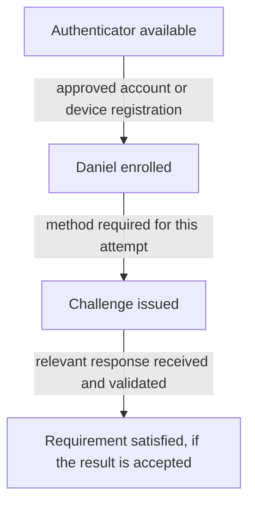

# Day 7: Authenticators, enrollment, and MFA

This is a separate sign-in attempt from Daniel's earlier expense-approval problem. Daniel opens Northbridge Expense. His password is accepted, but he is asked to set up Okta Verify before continuing. His manager asks:

> We already enabled Okta Verify. Why does Daniel need to set it up?

Daniel has supplied a password the system accepts, yet he still cannot continue. The setup request concerns another way to prove his identity: Okta Verify, an app he can register for his Northbridge account. His manager's question combines making that option available with completing Daniel's own setup. Using it successfully during a sign-in is a further step.

Recall Day 6: an accepted password result does not establish that all sign-in requirements have been met. Today, follow Daniel from the available option through registration and then to the evidence required for a particular attempt. Your goal is to explain which step he has reached and choose the next check from that evidence. You can follow the case without installing the app or using an Okta tenant.

## Why a password may not be enough

A password is something Daniel knows. Someone else who obtains it might try to use it. Asking that person to enter the stolen password again would add little reassurance. Northbridge can instead require another kind of evidence, such as proof involving a registered device Daniel possesses. The purpose of the extra check is to require evidence that knowing his password alone does not supply.

An **authenticator** is a means of providing authentication evidence. A password, a supported security key, and Okta Verify are examples. Authenticators can support different **methods**, or ways of authenticating. For example, Daniel might respond to an Okta Verify notification on his registered phone. That tells us more about the interaction than simply saying he used Okta Verify. The authenticator's name alone does not describe every method or security property it supports.

A **factor type** describes the kind of evidence:

| Factor type | Plain meaning | Example |
|---|---|---|
| Knowledge | Something you know | A password. |
| Possession | Something you have or control | A registered device used to prove possession. |
| Biometric | Something you are | Fingerprint or face verification supported by a device. |

**Multifactor authentication**, or **MFA**, combines different factor types. It adds evidence beyond a single kind of proof.

Count the kinds of evidence, not the screens. Asking for two passwords is still asking for knowledge twice. Two prompts do not automatically establish two factors. Conversely, a supported authenticator interaction may establish more than one factor, such as device possession together with biometric verification.

In a successful password-plus-device attempt, accepted password evidence supplies knowledge, and the validated registered-device method supplies possession. Both results matter. The fact that he owns a phone, without the relevant registration and accepted proof, does not complete the device check.

MFA and authorization remain different. Stronger authentication does not grant Daniel an Expense approval role or create his application account. His Finance manager title alone does not establish the application permissions needed for his work.

Ask three questions about Daniel's check: 'What is he using?' Okta Verify, the **authenticator**. 'How is he using it?' By responding to Push, the **method**. 'What kind of proof can that validated interaction supply?' **Possession**, a factor type. These are three descriptions of the same interaction, not three separate checks. [Okta's Verify reference](https://help.okta.com/oie/en-us/content/topics/identity-engine/authenticators/configure-okta-verify.htm) describes its supported methods.

## Separate availability, enrollment, and use

Imagine Northbridge has made Okta Verify available for its users. Daniel installs the app on his phone. Is that enough to authenticate to Northbridge with it?

Installation puts the software on his phone. **Enrollment** is the account-specific registration that connects the authenticator to Daniel's Northbridge identity. During the approved setup, he adds that account to Okta Verify.

An app icon tells Alex the software is installed. It does not answer 'Is Daniel's Northbridge account registered on the device he needs?' That is the enrollment question.

Alex can turn the manager's broad question into checks with different evidence:

| Question | Evidence to inspect |
|---|---|
| Is the authenticator available under the applicable configuration? | Authenticator settings and enrollment rules for this user. |
| Has Daniel enrolled it for his Northbridge account? | The relevant enrollment and device/account association. |
| Is the method acceptable for this attempt? | The stated authentication requirement and supported method. |
| Did Daniel complete it successfully? | The authentication result for the identified attempt. |

Read the table as four questions about Daniel. The configuration may allow Okta Verify while his own registration is still missing. He may then complete registration but still need to provide the proof required for this sign-in. Each result answers a different question. A successful use yesterday does not automatically satisfy today's attempt; check whether earlier evidence may be reused under its requirements.

Keep device context in view. Enrollment on Daniel's old phone does not establish that a replacement phone is ready. Likewise, an account in Okta Verify for another organization does not establish a Northbridge enrollment.

## Two requirements with different jobs

Northbridge needs to decide both what Daniel must set up and what an access attempt must prove. A **policy** expresses configured requirements for a population or situation. These two purposes guide different decisions:

- An **authenticator enrollment policy** governs which authenticators users may or must enroll and when enrollment is required.
- An **authentication requirement** describes what proof is needed for an access attempt.

Think of these as 'What must Daniel set up?' and 'What must this sign-in prove?' Requiring registration prepares him to use the authenticator. It does not, by itself, decide how often every application must challenge him. Likewise, making enrollment optional does not mean that the method can never be needed to satisfy a particular application's requirement. Alex must inspect the requirement for the access attempt as well as the enrollment rule.

For the example below, Northbridge has made the following decisions. These are supplied assumptions, not universal Okta defaults:

| Decision | Daniel's applicable requirement |
|---|---|
| Enrollment | Okta Verify enrollment is required now; no postponement applies. |
| Expense authentication | This fresh attempt needs accepted password evidence and an accepted Okta Verify Push response. |
| Method availability | Push is enabled and supported on Daniel's mobile device. |
| Prior authentication | No earlier verification is being reused to satisfy the Push requirement in this packet. |

Under these supplied conditions, Daniel needs a completed enrollment and, for this fresh attempt, accepted password and Push evidence. There is no earlier Push verification to count and no enrollment postponement to explain the setup request away. Keep those conditions with this example; another application's requirements could differ. Day 13 examines how policies and sessions determine the requirements for an attempt.

## Follow Daniel's enrollment question

Alex collects this synthetic packet for attempt D-1. It is a plain-language summary, not a raw Okta event:

| Observation | Evidence |
|---|---|
| Daniel's Okta identity | Correct account; Active. |
| Authenticator configuration | Okta Verify is enabled and allowed for Daniel. |
| Applicable enrollment requirement | Enrollment required now. |
| Daniel's Northbridge enrollment | No completed Okta Verify enrollment found for this account. |
| Password result for D-1 | Accepted. |
| What Daniel sees | A request to set up Okta Verify. |

Predict the explanation before reading on: which two facts did the manager combine?

The enabled setting answers the organization's configuration question. Daniel's enrollment row answers a different question: this Northbridge account has no completed registration. Because enrollment is required now, the setup request fits the supplied evidence. Alex can explain that Northbridge has made the option available, but Daniel still needs to connect it to his own account through the approved setup.

The next useful action is to guide Daniel through that approved enrollment path and verify the resulting association with the correct Northbridge account and supported device. The password result is already accepted in D-1. Resetting it would address a different part of the sign-in, while changing his department would not establish the missing registration.

Enrollment itself is security-sensitive: it establishes a means of proving identity. If Daniel cannot complete it, the next question concerns the actual enrollment failure and approved assistance process, rather than removing the requirement just to make the prompt disappear.

## Enrollment does not answer a challenge

Suppose Daniel subsequently completes the approved enrollment. In a new attempt D-2, the same stated Expense requirement applies. His password is accepted, and a Push request is issued to the registered device. No accepted response is yet recorded.

Now the missing fact has changed: setup is complete, but this attempt still lacks an accepted response. A **challenge** is a request for authentication proof. For Push, the request goes to the registered device and Daniel responds through it. The system must receive and accept the relevant response. Registration makes that interaction possible; it does not complete it for him. Daniel should approve only a Push request that belongs to a sign-in he is intentionally completing. Receiving a notification is not a reason to approve it automatically.

Start at the top with what Northbridge makes available, then follow Daniel's registration to the challenge for a particular attempt. The final arrow requires a response to be received and validated. That is why a record saying the challenge was issued cannot establish the result at the bottom. The diagram shows a conceptual relationship; authenticators can present different screens and interactions.

For D-2, enrollment is established but accepted Push evidence is not. Before reading further, choose what you would ask Daniel and what you would inspect for this attempt. “Issued” does not prove that he received or approved the notification. His experience, the selected enrollment/device, and the response outcome help locate the gap between sending a challenge and obtaining accepted proof.

An expired challenge, a user denial, and an undelivered notification are different findings. If the selected device is an old phone, that points to a different next check than a recorded denial on the intended phone. These are possible explanations, not findings supplied for D-2. A broad “MFA failed” description hides the distinction Alex needs before choosing a correction.

For a successful follow-up, the investigator obtains an accepted response tied to the current attempt and confirms that the stated authentication requirement is satisfied. That is the result needed to close this authentication question. Application entry and permissions still need their own evidence; this follow-up does not resolve Daniel's separate Expense cases from earlier lessons.

## Okta Verify methods are not interchangeable

Okta Verify supports several authentication experiences, subject to configuration and platform support:

| Method | What the user does conceptually |
|---|---|
| Time-based one-time password, or TOTP | Enters a changing code generated by the app. |
| Push | Responds to a notification on a registered mobile device. |
| FastPass | Uses a device-based cryptographic authentication flow through Okta Verify. |

The table describes different interactions. With TOTP, Daniel supplies a changing code from the app. With Push, he responds to a notification. FastPass uses cryptographic proof associated with the device, which we will examine next. Knowing he has Okta Verify does not identify which interaction took place.

A TOTP result is not a Push result, and two methods from the same app do not automatically prove two different factor types. Check both the method used and the kind of evidence it supplies.

In Northbridge's supplied Push example, inspect the Push outcome. Do not substitute an unrelated code result or an older event because it also says Okta Verify.

## Where FastPass fits

Suppose a separate, permitted sign-in flow lets Daniel use his enrolled device to provide proof without typing a password. [**Okta FastPass**](https://help.okta.com/oie/en-us/content/topics/identity-engine/devices/fp/fp-main.htm) uses Okta Verify to respond to a challenge from Okta with a cryptographic key associated with the device's registration. Okta checks the response as evidence that the enrolled key was used for this attempt. Daniel does not type a password in this example.

The device uses a **private key**, a cryptographic secret, to create a **digital signature** for its response. That signature is calculated proof that Okta can verify, tied to the challenge for this request. Okta checks the signature and whether the response matches its challenge. The important sequence is request, signed device response, then verification. For FastPass, Okta Verify must be set up on the supported device being used to access the application. That differs from a Push example in which Daniel can respond on a registered phone while signing in on a computer.

FastPass is not another name for approving a Push notification. It can provide phishing-resistant authentication in supported, correctly configured flows. **Phishing resistance** helps prevent authentication proof from being used through an impostor site. It does not mean every flow bearing the Okta Verify name has the same protection or that all forms of account compromise are impossible.

A flow can also require **user verification**, such as a supported device biometric or passcode check. Okta documents these [user-verification options in app sign-in policies](https://help.okta.com/oie/en-us/content/topics/identity-engine/policies/new-user-interaction-options.htm). This adds a check of the person using the device; having a registered device and completing a required local check are distinct facts. Whether the required proof was provided depends on the method, device, configuration, and actual result. “FastPass enabled” does not prove those conditions were met for an attempt.

Passwordless means the flow does not require a password; it does not mean “no authentication” or “automatically single-factor.” Do not infer factor count from whether a password field appeared.

For Northbridge, an AD password attempt still follows Day 6's delegated path. A separately permitted FastPass flow is not evidence that AD validated a password during that attempt. Do not silently change the authentication path when comparing incidents.

## Keep the evidence tied to the question

| Report | First distinction to investigate |
|---|---|
| “The app is installed, but setup is still requested.” | Installation versus correct account enrollment. |
| “Daniel is enrolled, but access asks for another check.” | Enrollment versus the current authentication requirement. |
| “A notification was sent, so MFA worked.” | Challenge issuance versus accepted response. |
| “Password accepted, so Expense must work.” | One authentication result versus all requirements and target access. |

Use the distinction in each row to choose the next investigation. Missing enrollment in D-1 calls for checking setup; missing accepted proof in D-2 calls for checking that attempt. Resetting an enrollment can make Daniel need setup again without explaining what happened to the Push request. Establish the missing result before choosing that change. Recovery and administrative responsibilities are developed later.

## Read the enrollment before choosing a reset

The user's authenticator information answers which enrollments are associated with that identity. The organization's authenticator configuration answers which methods are available. Inspect both before interpreting a report that “Verify is installed but does not work.” An installation may belong to another organization or lack the needed enrollment.

For an issued Push with no accepted response, first establish what the user experienced and read the attempt's outcome. If an old phone is unavailable, inspect which enrollment was selected and what approved recovery is needed. If the expected phone was used, inspect the relevant response result. Removing the enrollment before understanding the evidence can create a setup task while leaving the original cause unknown.

If replacement is necessary, follow the approved identity-verification and recovery process with the required authority. The completion evidence is a replacement enrollment and a permitted subsequent sign-in, not merely a completed reset action. Keep the detailed [replacement-phone situation](../requests/recovery-and-account-state.md) for after Day 14, when recovery responsibilities have been introduced.

Daniel's story turns on the step that has evidence. Availability explains what Northbridge offers; enrollment connects the authenticator to his account; the current result establishes whether the required proof was accepted. Explain the missing step before proposing a change, then keep the application outcome as its own check.

## Before moving on

Can you explain:

- The difference between an authenticator, a method, and a factor type?
- Why installing Okta Verify differs from enrolling Daniel's account?
- Why required enrollment differs from proof required for an attempt?
- What a challenge being issued proves and leaves unknown?
- Why two prompts do not automatically mean two factors?
- How Push and FastPass differ at a conceptual level?
- Why satisfied authentication still does not establish application permissions?

Try the [Day 7 exercises](../exercises/day-07.md), then read the [separate answers](../self-checks/day-07.md).

In [your notebook](../notebook/guide.md), record Daniel's availability, enrollment, required method, and attempt result as four separate facts. Explain which fact would change your next action.

[Day 8](day-08-saml.md) follows the identity information an application receives through SAML after the relevant Okta checks.

For more examples, open the [Day 7 practice bank](../question-bank/day-07.md). Each question includes its own context and an expandable teaching explanation.

[Previous: Day 6](day-06-active-directory.md) · [Course home](../index.md)

[Revise Day 7](../revision/day-07.md): revisit the concepts, example, and questions without rereading the full lesson.
