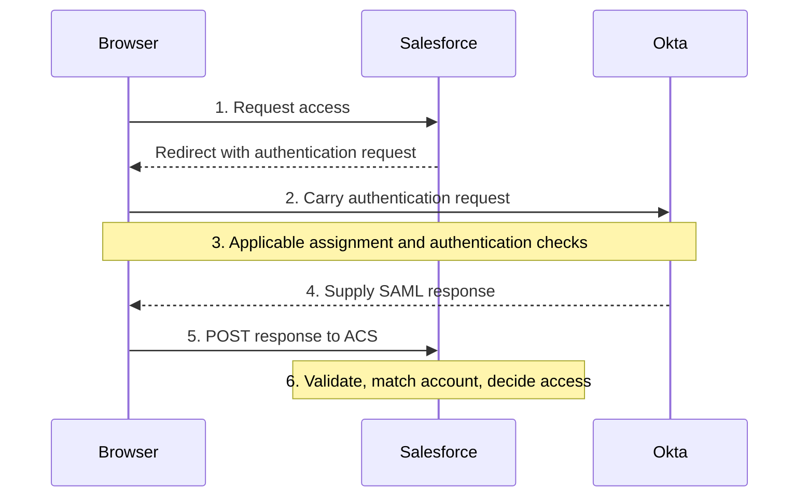

# Day 8: SAML and application sign-in

Maya opens Northbridge's Salesforce environment. She completes the required Okta checks, returns to Salesforce, and sees a sign-in rejection.

From Maya's point of view, she has done what Okta asked. Alex also finds a successful Okta SSO event for the same attempt. Yet Salesforce still has a decision to make: does the information arriving from Okta meet this application's sign-in requirements? Day 2 prepared you to separate those outcomes. Now follow the information across that boundary.

For this case, Salesforce is assigned to Maya, and her intended Salesforce account exists and is active. These are supplied facts for this incident; they do not retroactively resolve Day 1's incomplete ticket.

First picture the exchange without worrying about its message format. Salesforce sends Maya's browser to Okta; after the applicable checks, the browser carries identity information back to Salesforce for validation. Your goal is to explain that journey, distinguish delivery from acceptance, and use the rejection evidence to choose the field that needs investigation. You can practice this with the supplied message excerpt and reports, without a tenant.

## The application needs trustworthy identity information

Salesforce needs to know which user is arriving and whether it can trust the authentication behind that identity. Northbridge has already asked Okta to perform the applicable identity checks. In a **federated sign-in**, Salesforce can rely on information from Okta under a configured trust relationship. The two systems agree how to identify each other and what Salesforce must validate before using that information. This gives the application a way to recognize Maya without receiving her password.

**SAML**, Security Assertion Markup Language, is a standard used for this exchange. In this example:

| Participant | SAML role | Responsibility |
|---|---|---|
| Maya | User | Starts the access attempt and completes required interactions. |
| Okta | Identity provider, or IdP | Performs the applicable identity checks and issues SAML information. |
| Salesforce | Service provider, or SP | Validates the received information, identifies the application user, and controls access. |
| Browser | Message carrier | Carries the browser-based exchange between the two services. |

Read the table as a division of work. Okta supplies identity information as the IdP; Salesforce evaluates it and controls entry as the SP. Maya completes the required interactions, while her browser carries the messages. The browser's role in delivery does not make it the authority deciding that Maya should be admitted. IdP and SP describe roles in this connection, not permanent roles that every system has in every integration.

Okta does not send Maya's AD password to Salesforce in this SAML flow. It sends an assertion about her identity and authentication. If AD validated her password earlier, that remains a separate step from what Salesforce receives.

## Request, response, and assertion

When Salesforce starts the flow, it can issue an **authentication request**, often called an `AuthnRequest`, asking the IdP to authenticate the user under the connection's requirements.

The IdP returns a **SAML response**. A successful response in this flow contains an **assertion**: statements about the user and authentication, with conditions governing their use.

In everyday language, Salesforce asks Okta, "Please authenticate the person trying to enter." That is the request. Okta sends its reply as the response. Inside the successful response, the assertion supplies the identity and authentication statements Salesforce must evaluate. These are related parts of the exchange, not three names for the same message.

Even a response with a success status can carry an assertion Salesforce must reject. Okta has supplied its reply; Salesforce still has to decide whether the information meets this connection's requirements.

Think of the assertion as answering questions such as:

- Who issued this information?
- Which user does it describe?
- Which application is it intended for?
- Under what conditions may it be accepted?

An assertion gives Salesforce material to check against its trusted configuration. Anyone reading text can see what it claims; that does not establish who produced it, whether it was altered, or whether this application may use it. Those questions explain why the validation step matters even after Maya completes Okta's checks.

## Follow the browser

Maya begins at Salesforce, which needs the identity information before admitting her. Salesforce starts the exchange by sending an authentication request through her browser to Okta. Because the service provider starts it, this is **SP-initiated**:



Follow the numbered steps from top to bottom. Maya's browser first asks Salesforce for access, then carries Salesforce's request to Okta. After the applicable checks, Okta supplies a response for the browser to deliver to Salesforce. For that last HTTP POST delivery, Okta can provide a web page containing an HTML form with the encoded response in a hidden field named **SAMLResponse**. The browser submits the form to Salesforce's ACS, often automatically. Maya normally does not see or manually enter the message. The XML used later in this lesson is a readable excerpt for study, rather than a screen Maya must fill in.

The application's **Assertion Consumer Service**, or **ACS**, is the receiving service for that response. Its configured **endpoint** is an address for that operation. Reaching the ACS establishes where the browser delivered the response; Salesforce still needs to validate what arrived. Recall Day 2: POST describes a message operation, not automatic account creation.

This diagram is a simplified browser exchange, not a complete network trace. An existing authentication context may affect which prompts occur; do not assume every SAML launch repeats every factor.

An **IdP-initiated** flow starts from the identity provider, such as launching an application from Okta. It does not begin with the same SP authentication request. Support and validation behavior depend on the integration. Changing where the flow starts does not remove the SP's obligation to validate the response.

## The two sides need agreed configuration

Before this exchange can work, both sides need the details of the intended connection. Okta needs to know which application the assertion is for and where to send the response. Salesforce needs the trusted identity-provider and signing information used to validate it. **SAML metadata** describes connection information such as identifiers, endpoints, and signing certificates. An integration may exchange a metadata document or configure the relevant values separately. Metadata helps communicate the agreement; the actual message must still satisfy it.

An **entity ID** identifies a SAML participant. Even when it looks like a web address, it serves as an identifier; it is not automatically the endpoint receiving the browser's message.

Keep destination and identity separate. The ACS URL tells the browser where to deliver the response. The SP entity ID identifies the intended application. A response can arrive at the right address while the assertion names a different intended application. That is the distinction Alex needs to investigate Maya's rejection.

**Audience** answers “which service may use this assertion?” **NameID** answers “which user does it describe?” under the connection's chosen matching rule. The **ACS URL** answers “where is the response delivered?”

For Maya, reaching Salesforce's receiving address does not establish that the assertion names the production Salesforce connection. Naming that connection correctly would still leave another question: does the user identifier match Maya's intended account? Each value has its own job.

Northbridge uses these fictional teaching values for its production Salesforce connection. They are not real Salesforce endpoint formats to copy:

| Meaning | Expected value |
|---|---|
| Trusted IdP issuer | `https://identity.northbridge.example/saml/idp` |
| SP entity ID / expected audience | `https://salesforce.northbridge.example/entity/prod` |
| ACS destination | `https://salesforce.northbridge.example/saml/acs` |
| User identification choice | NameID must match the intended Salesforce username. |
| Maya's approved Salesforce username | `maya.rao@northbridge.example` |

Use the table by asking what each value identifies. The issuer names the trusted IdP, the audience names the intended SP, the ACS gives the receiving address, and NameID supplies the user identifier under the selected rule. A correct user identifier cannot compensate for a value naming the wrong application.

Other deployments may use a configured Federation ID instead of username matching. Here, **Federation ID** means a separate user identifier the application can use to match a federated sign-in. Inspect the selected identity rule; an email-looking value is not automatically the right application identifier.

## Read a small piece of XML

SAML uses **XML**, a text format with named elements. An opening tag such as `<saml:NameID>` begins an element; `</saml:NameID>` ends it. Text between them is its value. Elements can contain other elements.

A prefix such as `saml:` identifies a namespace: the vocabulary those element names belong to. In the excerpt below, `xmlns:saml` declares that vocabulary. You do not need to memorize the namespace address.

This is a synthetic, shortened assertion excerpt for Maya's rejected attempt S-1. It preserves only the fields being compared. It omits required surrounding content, signature material, authentication statements, and validity fields. It is not a complete or usable SAML assertion.

```xml
<saml:Assertion xmlns:saml="urn:oasis:names:tc:SAML:2.0:assertion">
  <saml:Issuer>https://identity.northbridge.example/saml/idp</saml:Issuer>
  <saml:Subject>
    <saml:NameID>maya.rao@northbridge.example</saml:NameID>
  </saml:Subject>
  <saml:Conditions>
    <saml:AudienceRestriction>
      <saml:Audience>https://salesforce.northbridge.example/entity/test</saml:Audience>
    </saml:AudienceRestriction>
  </saml:Conditions>
</saml:Assertion>
```

Start with three named elements, leaving the surrounding structure in place. Issuer names the party claiming to issue the information. NameID inside Subject supplies the user identifier. Audience inside AudienceRestriction names the intended service. Compare those values with the earlier configuration table before reading on.

The excerpt names the expected issuer and Maya's approved username, but its audience identifies the test application configuration. The expected audience identifies production. You have located a visible discrepancy. The application report later in the lesson will establish whether that discrepancy caused this rejection; the shortened XML alone cannot tell you the outcome of all the checks.

## What the application must validate

For today, focus on who issued the information, which application it is intended for, which user it identifies, and whether the application accepted it. The other checks remain important. Understand their purpose without trying to memorize every SAML field yet.

Suppose the username looks correct. Salesforce still needs to establish that the required signed content verifies under its trusted configuration, is intended for this connection, and is usable for the current attempt. Otherwise, a plausible-looking identity string would be enough to bypass the sign-in decision. The checks below explain what the application must establish:

| Check | Why it matters |
|---|---|
| Issuer | The message must come from the expected identity provider. |
| Signature and trusted signing key | The SP must verify the required signed content using the configured trust information. |
| Audience | The assertion must be intended for this SP under the agreed configuration. |
| Recipient / destination | Delivery-related values must agree with the intended receiving endpoint as required by the flow. |
| Validity conditions | The assertion must be usable at the checked point; fields such as NotBefore and NotOnOrAfter constrain validity. |
| Request correlation and replay checks | Where required, the response must belong to the expected request and must not be reused improperly. |
| User identification | The validated identity must map to the intended account under the application's chosen rule. |

A **digital signature** lets the recipient verify the signed data against trusted signing information. The **signing certificate** supplies public-key information for that check. The private signing key creates the signature; the corresponding public key lets the recipient verify it. The trusted configuration connects that check to the expected issuer. Merely seeing a signature element or certificate does not establish successful verification.

Signing and encryption have different purposes. Signing supports checking the origin and integrity of the signed content. Encryption protects content from being read without the required decryption key. A signed message can therefore still be readable. Even successful signature verification does not settle whether the signed assertion names the right audience or meets its validity conditions.

Likewise, displaying or decoding an assertion is not validating it. The shortened excerpt cannot establish signature or time checks. Those require the full relevant message and validation evidence. Clock differences can matter when investigating a validity rejection, but an expiry label alone does not prove which clock or setting is wrong.

**Request correlation** means connecting the response to the request that started this attempt, where the flow requires that connection. **Replay** means presenting previously issued information again; replay checks prevent improper reuse. A signed assertion from an earlier exchange is not automatically acceptable for a new one.

Each row answers a different acceptance question. A valid signature does not replace the audience check, and an acceptable audience does not replace account matching. The table groups these checks by purpose; it does not prescribe a universal order in which every application performs them.

## Establish the audience defect

Alex obtains the following synthetic evidence for S-1. The expected values belong to the checked production instance, and the full response observations are correlated to that same attempt.

| Evidence | Finding |
|---|---|
| Okta SSO event | SUCCESS for Maya and the relevant application attempt. |
| Expected audience | The production entity ID shown above. |
| Audience in the full assertion | The test entity ID shown in the excerpt. |
| Application validation report | Rejects the assertion because the audience differs from its configured entity ID. |
| Issuer, required signature, and validity checks | Reported as accepted in the supplied validation evidence. |
| Intended account record | Active; approved username matches the excerpt's NameID. |

Before choosing a change, compare the expected audience, the audience actually sent, and Salesforce's rejection reason. All three point to the same defect: the production connection received the test audience, and Salesforce rejected it for that reason. This is stronger evidence than noticing a suspicious string by itself.

The packet also reports accepted issuer, required-signature, and validity checks. Those conclusions come from the supplied validation evidence, not from the shortened XML. Maya's active account and matching approved username are supplied too. Keep those established facts while investigating the failed audience check.

Alex should compare the approved connection settings on both sides and identify the value responsible for emitting the test audience for this production attempt. The correction must bring the emitted value into agreement with the intended connection. Review the affected integration before changing it, because other users may use the same configuration. Disabling audience validation would remove the check that caught the mismatch. Changing Maya's correct username would alter a different field without correcting the audience.

A saved setting is only the proposed correction until a new attempt supplies the result. Verify that the new message contains the production audience, Salesforce accepts the response, and Maya reaches her intended account. These are the conditions for verifying the correction, not results already supplied for S-1. The original SUCCESS event cannot verify a new attempt.

## A different NameID calls for a different investigation

In a separate variation S-2, the audience and required validation checks pass. The assertion instead carries `maya.old@northbridge.example`; the approved target username is still `maya.rao@northbridge.example`. The application reports that it cannot find a user under its configured username-matching rule.

Now choose the next check using S-2's own evidence. The audience and required validation checks pass, but the presented user identifier differs from the approved username under this connection's matching rule. This is an identity-matching discrepancy. Follow the application username/NameID mapping and the linked target record, using Day 3's distinction between a configured mapping and the value actually delivered. Changing the audience again would address the wrong field. Creating another account before resolving the intended association could add a second problem.

The comparison also depends on the matching rule. If a connection expects Federation ID, comparing only the target's username would not establish the correct match. Configuration supplies the meaning of the value.

## Authentication does not define the account lifecycle

SAML sign-in and account management remain separate concerns. The main example assumes an existing active Salesforce account and no account creation during this sign-in.

Some applications can separately support **just-in-time provisioning**, or **JIT**, which creates or updates an account during a configured sign-in journey. That is additional account-management behavior using the sign-in context. It must be supported and configured; receiving a SAML assertion does not guarantee it. For Maya's current case, use the supplied fact that her active account already exists. Day 11 returns to account creation and matching choices.

After a response is accepted, the application establishes its own sign-in/session outcome and applies its permissions. SAML acceptance does not automatically give Maya every Salesforce action. If she enters the correct account but an action is denied, investigate the relevant application authorization requirement, as with Daniel on Day 1.

## Compare the two sides of the connection

Alex needs three things beside one another: the Okta connection settings, the intended application's configuration, and the actual message for the attempt. The application integration's Sign On settings describe the Okta side. First confirm that all three belong to the same production or test connection, then compare issuer, audience, ACS, and user identifier. This prevents a correct setting from one connection being used to explain a message from another. A saved setting does not prove what was emitted.

A signing-certificate change needs coordination too. The certificate identifies a public key the application can use to verify signatures; it is not the user's password. Generating a new certificate does not by itself establish that the application trusts it. Inspect the active signing choice, the application's trusted certificate, and the supported transition process before activation. See [signing-certificate settings](https://help.okta.com/oie/en-us/Content/Topics/Apps/manage-signing-certificates.htm).

After a change, verify a fresh response and target acceptance. Do not use an old application session as proof that the new signing relationship works. The [connection-maintenance situation](../requests/connection-maintenance.md) develops this comparison after Day 14.

Maya's investigation becomes clearer when each value has a job. The ACS tells you where the response arrived, the audience tells you which service the assertion is intended for, and NameID identifies the user under the selected matching rule. Compare the observed values with the approved connection, then use the application's validation evidence to decide which discrepancy explains the failure.

## Before moving on

Can you explain:

- Which participant is the IdP, which is the SP, and what the browser carries?
- How request, response, and assertion differ?
- Why ACS destination and audience are different concepts?
- How NameID matching depends on the selected application identity rule?
- Why readable XML and a signature element do not prove validation?
- What establishes the cause in S-1 and what changes in S-2?
- Why successful federation is not proof of account provisioning or every application permission?

Try the [Day 8 exercises](../exercises/day-08.md), then read the [separate answers](../self-checks/day-08.md).

In [your notebook](../notebook/guide.md), draw the browser flow and annotate the issuer, intended audience, receiving endpoint, and user identifier. Keep expected configuration beside observed message values.

[Day 9](day-09-oidc.md) follows Northbridge Expense through OIDC, a different sign-in protocol.

For more examples, open the [Day 8 practice bank](../question-bank/day-08.md). Each question includes its own context and an expandable teaching explanation.

[Previous: Day 7](day-07-authenticators-enrollment-mfa.md) · [Course home](../index.md)

[Revise Day 8](../revision/day-08.md): revisit the concepts, example, and questions without rereading the full lesson.
