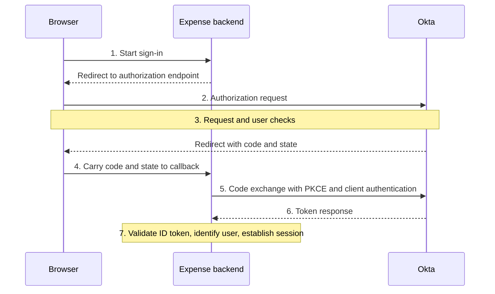

# Day 9: OIDC and the authorization code

Maya opens Northbridge Expense. Instead of returning to her expense page, the sign-in journey stops with a message that the return address is not permitted.

Maya expected to come back to Expense after the identity checks. Alex needs to understand how Expense tells Okta where that return should go, and why Okta can refuse the requested address before the rest of the journey takes place.

The application uses **OpenID Connect**, or **OIDC**. As with SAML, the application relies on an identity service and must validate what it receives. This time, the browser brings back a temporary code, and Expense's server uses that code in a further exchange. The messages and their purposes are different.

Start by locating the stage that failed. A rejected return address is not the same problem as an application rejecting a token it has already received.

Your goal is to follow one journey: browser returns code → backend exchanges code → application validates identity information and decides access. Place each new term on that journey rather than memorizing it in isolation. As you read, keep asking which participant acts next and what result would show that the step completed. The supplied observations are enough to practice this reasoning without a tenant or a working application.

## OAuth and OIDC answer related questions

An application can need permission to call a protected service, and it can need information about the person signing in. Those are related needs with different receiving systems and checks. **OAuth 2.0** is a framework for authorizing access to protected resources, such as APIs. A client can obtain an access token to present to an intended resource service. That is different from a standard statement establishing who signed in to the client application.

OIDC adds an identity layer to OAuth 2.0. It defines an **ID token** and rules the client uses to validate authentication information about the user. For Expense's sign-in question, the useful result is validated identity information that Expense can associate with the intended account. An access token has a different job at its intended resource service.

A **token** is a data value issued for a defined purpose. Its name and the receiving system's checks matter: an ID token carries identity claims for the client; an access token is presented to its intended resource service. That service, often an API, is called the **resource server**.

| Question | Relevant concept |
|---|---|
| How can an application obtain authority to call a protected API? | OAuth and an appropriately issued access token. |
| How can the application verify information about the user's authentication? | OIDC and ID token validation. |

Follow the purpose in each table row to the receiver that checks it. Expense validates the ID token for its sign-in. A resource server evaluates an access token for a resource request under its own rules. Readable user information in an access token does not change that purpose. Neither token automatically creates an application account or grants every application permission.

## Fix the client type before tracing the flow

Northbridge Expense is a fictional web application with a server-side **backend**: application software running on its servers, rather than in Maya's browser. The backend processes sign-in responses and can protect its client credentials. This is a **confidential client**. A **client** is the application participating in the OAuth/OIDC exchange; it is not Maya's user account.

Day 2 called the browser an HTTP client because it makes web requests. Here, **OIDC client** identifies Expense's role in the sign-in protocol. The browser carries messages for that flow, but Expense's backend performs the code exchange and validates the ID token. Always name which exchange the word *client* refers to. See [OIDC's client role](https://openid.net/specs/openid-connect-core-1_0.html#Terminology).

Keep this server-side design in view throughout the lesson. Maya's browser carries redirects; Expense's backend performs the exchange and can protect confidential material. The example uses Authorization Code with PKCE and configured backend client authentication. Other client designs exist, but we will use this one consistently so that each message has an identifiable sender and receiver.

| Participant | Responsibility in this example |
|---|---|
| Maya and her browser | Start access and carry redirects. |
| Expense backend | Acts as the OIDC client, exchanges the code, validates identity information, and establishes its application session. |
| Okta | Acts as the OpenID Provider and authorization server, applying requirements and issuing the configured responses. |

An **authorization server** issues OAuth responses and tokens. In this OIDC flow it also serves as the **OpenID Provider**. These roles describe this connection, not every role a product might have.

Okta also needs to know which application is asking. A **client ID** identifies Expense's registration. It is not a password. The identifier names the client; backend client authentication separately proves the client using its configured credential or key. That confidential material stays protected on the backend and does not belong in a browser redirect. Keep the application's identity distinct from Maya's identity.

## Follow one successful journey

Before looking at the failure, trace the intended journey. An **authorization code** is a temporary, single-use value that the client exchanges for tokens. In this architecture, Maya's browser delivers it to Expense, and the backend presents it to Okta under the exchange requirements. Maya does not type it like an MFA code, and Expense does not use it to call a resource API.



The **callback**, or redirect URI, is the application's registered return location. The **authorization endpoint** receives the authorization request. The **token endpoint** receives the backend's code exchange. An endpoint is an address for a particular operation.

Read the diagram from top to bottom and pause at Step 4. The browser has returned the code and state to Expense's callback. That hands the next operation to the backend. At Step 5, the backend communicates with Okta directly, presenting the code with the required PKCE proof and client authentication. Okta's token response returns to the backend.

Expense then validates the identity information, associates the user with its account, and establishes its application session. That session is Expense's result for continued application use; it is not another name for the code or ID token. A failure at the backend exchange would need different evidence from a browser that never reached the callback.

The actual authentication interaction depends on the applicable requirements and existing context. Do not assume every request displays a new password prompt or a consent screen.

## Read the request's purpose

Here are selected, decoded parameters from a synthetic successful authorization request. This is a readable field list, not a complete URL or runnable request. All addresses and identifiers are fictional.

| Parameter | Example value | Meaning |
|---|---|---|
| client_id | `nb-expense-web` | The intended Expense registration. |
| response_type | `code` | Request an authorization code. |
| scope | `openid profile` | Request OIDC sign-in and the supported profile-claim category. |
| redirect_uri | `https://expenses.northbridge.example/oidc/callback` | The registered application return location. |
| state | A fresh transaction value, omitted | Correlate the returned browser response with the request. |
| nonce | A fresh transaction value, omitted | Bind the returned ID token to this authentication request. |
| code_challenge / code_challenge_method | A derived value, omitted / `S256` | Establish the PKCE check for the later code exchange. |

Read the request as Expense's instructions for this transaction: which registration is asking, what response it wants, which information categories it requests, and where the browser should return. The transaction values add checks that connect the later messages to this request.

`openid` makes this an OIDC request. A **scope** names requested access or information categories. A **claim** is a named statement in returned information, such as a subject identifier. Requesting `profile` does not guarantee every conceivable profile field will appear in every token. The scope describes a request; a claim is information actually returned. Neither by itself establishes an expense-approval permission.

State travels out with the request and back with the browser response; Expense checks that return against the transaction it started. Nonce also begins in the request, but its later comparison is inside the ID token. Because this example sends a nonce, Expense must check that token's nonce against the original value. The two checks occur at different points. Matching either value does not replace all other validation.

## What PKCE adds

**PKCE**, Proof Key for Code Exchange, ties code redemption to a value the client created for that transaction. Expense keeps a secret random **code verifier** for the transaction and sends a derived **code challenge** with the authorization request. During redemption, it supplies the verifier, which the authorization server checks against the earlier challenge.

The two-stage arrangement matters. Sending the derived challenge first lets Okta later check whether the presented verifier belongs with this code. Someone who obtains the code without the required verifier lacks that proof for redemption. This helps protect against code interception or injection. The verifier is a transaction secret, not Maya's password. In this confidential-client example, PKCE complements configured client authentication.

The request's `S256` names the method that derives the challenge using SHA-256, a one-way cryptographic calculation, and a URL-safe encoding. The authorization request carries that derived challenge, while the backend retains the verifier for the later exchange. See the [PKCE specification](https://www.rfc-editor.org/rfc/rfc7636.html#section-4.2).

You do not need to calculate the challenge to investigate the flow. Recognize that a code arriving at the callback is only an intermediate step; the exchange has its own requirements and outcome.

Keep three points in the journey in view: the browser returns a response, the backend exchanges the code, and Expense validates the ID token. State, PKCE, and nonce protect those different points:

| Check in this example | Where it is checked | Relationship it checks |
|---|---|---|
| State | Expense checks the browser's returned response. | Does it correspond to the transaction Expense started? |
| PKCE | Okta checks the verifier during code exchange. | Does the verifier match the challenge associated with this code? |
| Nonce | Expense checks the returned ID token. | Does its nonce match the value sent for this authentication request? |

Passing one check does not replace the others or the remaining ID token checks. See the [OIDC code-flow definition](https://openid.net/specs/openid-connect-core-1_0.html#CodeFlowAuth) and the PKCE reference above.

## Three artifacts, three purposes

A successful token response in this example includes an ID token and an access token. This synthetic JSON shows selected field names only. The strings are explanatory placeholders, not real or encoded tokens:

```json
{
  "id_token": "ID_TOKEN_PLACEHOLDER",
  "access_token": "ACCESS_TOKEN_PLACEHOLDER",
  "token_type": "Bearer"
}
```

| Artifact | Used by | Purpose |
|---|---|---|
| Authorization code | Expense backend at the token endpoint | Obtain the token response under the exchange requirements. |
| ID token | Expense as the OIDC client | Validate information about the user's authentication. |
| Access token | Its intended resource server | Authorize an API request after the relevant token and permission checks. |

Both tokens appear because this successful OIDC exchange returns identity information for the client alongside a token for resource access. Expense uses the ID token for its authentication decision. The access token could be presented to its intended resource service when a permitted call is needed. No such API request is supplied here: receiving that token does not mean Expense used it. A successful handoff at one boundary does not establish the next boundary's result.

**Bearer** means possession of the token is sufficient to present it for use, subject to validation. Treat it as sensitive. Its existence does not show that any API call succeeded.

This sign-in example does not add a custom Expense API or assume that an Okta-issued access token is valid for an arbitrary API. The intended resource, issuer configuration, scopes, and validation contract determine where it can be used.

## Read claims without claiming validation

An ID token uses **JWT**, JSON Web Token, to represent claims. A readable decoded payload reveals content; it does not prove authenticity or acceptance. The following selected claims are a synthetic illustration, not a complete ID token:

```json
{
  "iss": "https://identity.northbridge.example",
  "sub": "subject-maya-1042",
  "aud": "nb-expense-web"
}
```

`iss` identifies the issuer. `sub` identifies the subject within that issuer. `aud` identifies the intended audience; for this single-audience ID token, it is Expense's client ID. Northbridge associates the validated issuer/subject pair with the intended local account, rather than assuming email is an immutable global identifier.

The client checks the expected issuer and audience, validity such as expiration, nonce for this request, and the applicable cryptographic validation using trusted provider information. Signature verification requires the actual token and appropriate trusted keys; looking at decoded JSON is insufficient. The excerpt omits signature and other required claims, including expiration and issuance information.

The selected claims let you compare what the payload says with Expense's expectations. The complete validation result answers whether Expense could rely on it. Keep the questions at this purpose level: who issued it, who it describes, who it is intended for, and whether it is valid for this transaction. A JWT-shaped string is not automatically an acceptable ID token or access token. This is the same reading-versus-validation distinction you used with Day 8's XML.

## Find the redirect mismatch

Return to Maya's incident O-1. The investigator has matched these observations to the same authorization request and registration:

| Evidence | Observation |
|---|---|
| Approved Expense callback | `https://expenses.northbridge.example/oidc/callback` |
| Registered sign-in redirect URI | Exactly the approved callback above. |
| Actual request redirect_uri | `https://expenses.northbridge.example/oidc/callback-old` |
| Request validation result | Rejected because the requested redirect URI is not registered. |
| Code issued for O-1 | None. |
| Code exchange for O-1 | Did not occur. |

Before proposing a change, compare the approved callback, registered callback, actual requested address, and rejection reason. Which side differs from the agreement? The registration matches the approved design; Expense's request still names the old callback. The report confirms rejection on that basis, and no code was issued. That establishes the first demonstrated defect.

Because the requested callback is not registered, Okta rejects this request before issuing a code. It must not redirect Maya's browser to that unapproved address, even to send back the error. The identity service can display an error instead, and the sign-in journey stops. Expense receives no code for O-1, so its backend has nothing to exchange. Exact redirect matching protects the destination of the response.

The supported proposal is to correct the application configuration that emits the old callback and verify a new request. Adding the obsolete address would expand the agreement to accommodate the wrong request. Broadening destinations indiscriminately would weaken that boundary, while resetting Maya's authenticator would address a different part of the sign-in. Choose the change that repairs the demonstrated discrepancy.

O-1 has no issued code or token exchange. Searching for the cause in an ID token from another attempt would cross an evidence boundary. A token-audience problem belongs to a later stage that this attempt did not reach.

## Verify the correction through the remaining stages

For a new attempt O-2, the investigator records:

1. The request uses the approved registered callback and is accepted.
2. After the applicable checks, a code returns to that callback; Expense verifies state.
3. The backend completes the authenticated code exchange with its matching PKCE verifier.
4. Expense validates the returned ID token, including its expected nonce, and identifies Maya's intended account.
5. Expense establishes its application session and Maya enters the application.

Trace each recorded result back to the diagram. O-2 passes the request check, returns a correlated code, completes the backend exchange, validates the ID token, identifies the intended account, and establishes actual Expense entry. This linked follow-up reaches the later stages that O-1 never reached.

You can report successful application entry for O-2. Expense-approval permission and a provisioning operation remain unestablished. The protocol changed, but the distinction between sign-in, account management, and application authorization still applies.

## Compare with SAML

| SAML example from Day 8 | OIDC example here |
|---|---|
| Browser carries a response containing an assertion to the ACS. | Browser returns a code to the callback; backend exchanges it for tokens. |
| SP validates the assertion under its trust configuration. | Client validates the ID token and transaction under its OIDC configuration. |
| NameID is interpreted through the configured matching rule. | Expense uses the validated issuer/subject identity for its account association. |

Start with the first row: the browser's return contains different material in these examples. Day 8 carries a SAML response containing an assertion. Here, the code leads to a separate backend exchange before Expense obtains the ID token. Both require application-side validation and a configured account association, but their messages and checks are not interchangeable. Neither protocol alone proves account creation or complete application authorization.

## Read the registration as an agreement

Compare Expense's integration registration with the request its backend actually creates. Keep the client identifier, allowed sign-in redirect URI, intended grant, and configured client-authentication method together. The application owner maintains the corresponding application-side values.

In O-1, these comparisons identify the application request as the side that needs correction. The application owner can investigate why Expense is generating the obsolete address. After the approved change, follow a new attempt through code return, backend exchange, validation, and entry. A saved registration or an old working session cannot supply those new results.

If the code is returned but the exchange fails, the next evidence comes from that exchange. Its client-authentication result and PKCE check matter there; an earlier browser redirect cannot prove either. Request the error and relevant identifiers without copying client secrets or complete usable tokens into a ticket. If one registration serves several deployments, identify them before changing shared settings.

For a new OIDC report, locate the last completed stage before naming a cause. No code in O-1 means the investigation starts with request validation. A returned code hands the next check to the backend exchange. A returned ID token still needs validation before Expense can rely on its identity information. Let that progression guide your next evidence request.

## Before moving on

Can you explain:

- How OAuth and OIDC relate?
- Which steps use the browser and which use Expense's backend?
- Why the code, ID token, and access token have different purposes?
- Why a scope is different from a claim?
- What state, nonce, and PKCE protect at a purpose level?
- Why decoded claims do not establish token validity?
- Why O-1 should be investigated before token processing?

Try the [Day 9 exercises](../exercises/day-09.md), then compare with the [answers](../self-checks/day-09.md). The optional final comparison in the answer file considers a later token rejection.

In [your notebook](../notebook/guide.md), draw the browser and backend as separate participants. Mark the last completed stage before proposing the next evidence request.

[Day 10](day-10-scim.md) returns to account management through SCIM.

[Previous: Day 8](day-08-saml.md) · [Course home](../index.md)

[Revise Day 9](../revision/day-09.md): revisit the concepts, example, and questions without rereading the full lesson.
