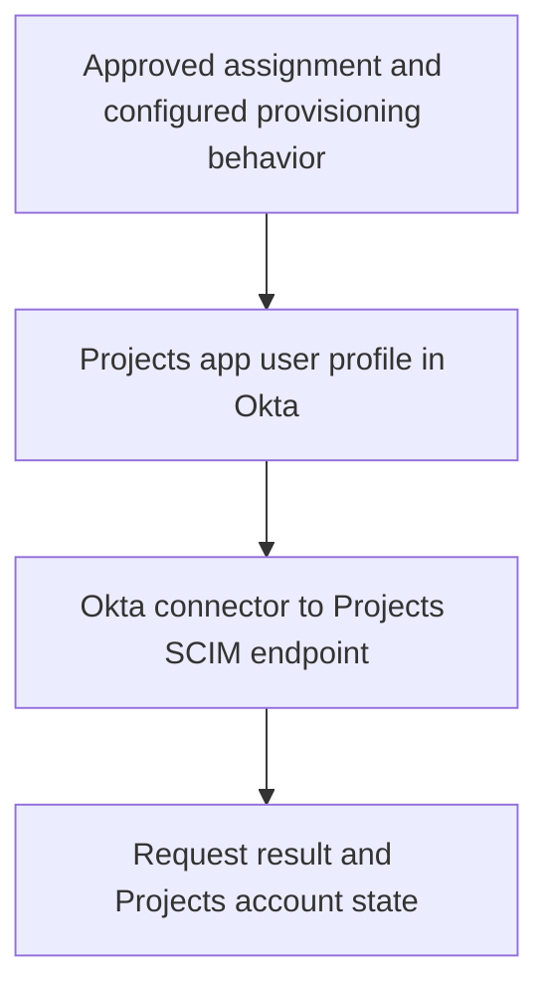

# Day 10: SCIM and application accounts

Devi needs Northbridge Projects for her work. Her assignment in Okta is approved, yet the support ticket says, “Assigned, but no usable Projects account.” Alex can see the assignment. He still needs to find out what happened in Projects itself.

The earlier sign-in lessons followed information that helps an application recognize a person. Here the question is about the account itself: does Projects have the intended account, with the required information and state? An assignment establishes a relationship in Okta. A separate account-management operation must reach Projects and be accepted. The target may reject it, or an account may already exist and need careful identification.

Follow the prepared information from Okta to a request, then compare the response with the actual Projects record. We will first read a successful create, then examine a conflicting username and a rejected department value. Finally, we will distinguish an update from deactivation. Your goal is to identify the operation and target record, explain the outcome, and choose the next useful check without confusing account management with sign-in.

## Follow the account-management path

Projects needs a way to receive account-management instructions from another system: create this user, update the account information, or disable the account. **SCIM**, System for Cross-domain Identity Management, standardizes exchanges for managing identity resources. Here Okta is the SCIM client sending requests, and Projects is the service provider receiving them. A **resource** is an object managed through the interface, such as a user account.

These roles belong to this account-management exchange. Okta is the SCIM client here, while Expense was the OIDC client on Day 9. Projects being a SCIM service provider does not tell us which sign-in protocol it uses.



Read the diagram from the approved assignment toward the target result. In the successful C-1 example below, Okta prepares Devi's user name and department code in the Projects app user profile. The configured connector sends a create request to Projects. Projects creates the account and returns its identifier; Alex then checks that record's values and state. The last box matters: preparation and transmission still need a response and a check of the intended account.

This is a backend exchange, not Devi's browser sign-in. The connector needs its own configured authorization to call Projects. Devi successfully completing MFA does not prove that this connection works. Nor is an Expense ID token a credential for this connection. Alex investigates the service connection separately from Devi's authentication.

The destination is Projects' SCIM interface. It is not an Okta management API endpoint. Naming both the caller and receiving system helps you interpret an HTTP response correctly.

## State the application's contract

Before judging a request, Alex needs to know what Projects agreed to accept. An **integration contract** describes supported operations, expected fields, and behavior. It gives the investigation a concrete reference: which operation is allowed, which value belongs in which field, and what an accepted result should mean. These are the assumptions for the fictional Projects connection:

| Item | Projects contract in these examples |
|---|---|
| Protocol and destination | SCIM 2.0 at `https://projects.northbridge.example/scim/v2`. |
| Supported operations | Find, create, update, and deactivate users. Create, profile updates, and deactivation are enabled for the relevant operations. |
| User name | `userName` must be unique within this Projects instance. |
| Department | Required code: SAL, FIN, or IT, retaining Day 3's departmentCode rule. |
| Wire representation | The app profile's departmentCode is sent as department in SCIM's enterprise User extension. |
| Target identifier | Projects assigns an `id`; later operations address the linked resource using that identifier. |
| Deactivation | `active: false` disables the account for new access under Projects' rules and retains the account record. Existing sessions require a separate check. |

Start with the user name, department and target-identifier rows. Projects requires a unique user name and an accepted department code; it assigns the identifier used for later operations on the account. These details will distinguish the two failures.

The department codes are Projects requirements, not universal SCIM rules. The enterprise extension is a standard place for organizational attributes; this application's accepted values are its own contract. A long schema identifier names the data definition. It is not an address to visit.

**Wire representation** means the fields and values actually sent in the request. Here the app profile calls the field `departmentCode`, while the request calls it `department` inside the enterprise extension. Think of two views: "What has Okta prepared for Projects?" and "What did the connector actually send to Projects?"

For Daniel's Finance department, the intended outgoing value is FIN. To check transmission, Alex must find FIN in the request's enterprise `department` field, not just in the app profile. The value and its location both matter.

Create and ordinary profile updates use POST and PUT in this example. The chosen connector uses PATCH for deactivation. Actual Okta integrations differ: custom integrations created through the App Integration Wizard use PUT for user updates, including deactivation. Read the relevant connector contract rather than assuming every update is PATCH. See [Okta's SCIM operations reference](https://developer.okta.com/docs/api/openapi/okta-scim/guides/scim-20).

## Read a create operation

Before creating an account, the connector asks Projects whether an account with the intended user name already exists. This lookup helps avoid creating another account where one already exists. A matching result can lead to the supported existing-account handling; a no-match result can lead to creation. The lookup result is evidence for that operation, not a guarantee that no later create can conflict.

Start with a successful teaching example C-1. It is separate from the later failure packets. Devi is still a Sales employee. Her approved assignment and Projects app profile are present; the preceding username lookup found no matching account.

The request goes to `/scim/v2/Users` using POST. Its content type is `application/scim+json`, a label telling the receiver that the body uses SCIM's JSON representation. Below is the complete illustrative resource body for this small contract; transport and authorization headers are omitted. This is synthetic evidence to read, not a command to execute.

```json
{
  "schemas": [
    "urn:ietf:params:scim:schemas:core:2.0:User",
    "urn:ietf:params:scim:schemas:extension:enterprise:2.0:User"
  ],
  "userName": "devi.rao@northbridge.example",
  "active": true,
  "urn:ietf:params:scim:schemas:extension:enterprise:2.0:User": {
    "department": "SAL"
  }
}
```

Read the familiar information inside the structure before studying its longer names: Devi's user name, the requested active state, and Sales represented as SAL. This is what Okta asks Projects to create; the request alone cannot tell Alex whether Projects did so. No `id` is supplied because Projects assigns it.

The `schemas` list names the definitions used by this resource. The long enterprise identifier appears again as a field name whose nested object holds `department`. You need to locate that object and read SAL; you do not need to memorize the identifier. The JSON Boolean `true` is a true-or-false value, written without quotation marks. Here it requests an enabled Projects account under the stated contract. It does not describe the separate Okta user's account status.

Projects returns HTTP **201 Created**, content type `application/scim+json`, and a Location header pointing to `https://projects.northbridge.example/scim/v2/Users/prj-1042`. Its response body is:

```json
{
  "schemas": [
    "urn:ietf:params:scim:schemas:core:2.0:User",
    "urn:ietf:params:scim:schemas:extension:enterprise:2.0:User"
  ],
  "id": "prj-1042",
  "meta": {
    "resourceType": "User",
    "location": "https://projects.northbridge.example/scim/v2/Users/prj-1042"
  },
  "userName": "devi.rao@northbridge.example",
  "active": true,
  "urn:ietf:params:scim:schemas:extension:enterprise:2.0:User": {
    "department": "SAL"
  }
}
```

The response also contains **meta**, metadata supplied by Projects. **resourceType** names this as a User resource; **location** gives its address, matching the Location header. The account identifier tells the connector which record it is, while that address tells it where the resource can be read. These are response details from Projects, not extra instructions Devi must enter.

Compare the response with the request. The target reports creation of prj-1042 and returns the account information. A subsequent read of that same resource confirms Devi's user name, SAL, and active state. The response reports the operation's result; the separate read checks the destination state. Together these support creation and the checked target state. They do not demonstrate an actual sign-in or project permissions.

Alex can now report more than “Devi is assigned.” For C-1, Projects created the account, and the checked record has the expected values. Whether Devi can enter Projects and perform her work remains a further question.

Here `Location` identifies the created resource; the `201` response is not Day 2's `302` browser redirect. A later read is a separate GET request for that resource. Interpret the header with its response status and operation. See [SCIM resource creation](https://www.rfc-editor.org/rfc/rfc7644.html#section-3.3).

Keep two questions apart: "What is this account's user name?" and "Which Projects record are we managing?" `userName` answers the first. Projects' assigned `id`, prj-1042 in C-1, identifies the resource used for later operations.

That target ID is not interchangeable with Devi's email, Okta object ID, or employee number. The connector's association connects the appropriate records. Similar-looking identifiers do not establish that relationship by themselves. See [SCIM's core schema](https://www.rfc-editor.org/rfc/rfc7643.html).

## A conflict requires an ownership decision

Now use independent packet C-2. C-1 showed the successful path; it does not supply account history for this different investigation. Do not carry C-1's created account into this packet.

Devi is assigned, and a create request with her expected user name reaches Projects. The earlier lookup returned no match. Projects' subsequent create response is HTTP **409 Conflict** with this synthetic body:

```json
{
  "schemas": ["urn:ietf:params:scim:api:messages:2.0:Error"],
  "status": "409",
  "scimType": "uniqueness",
  "detail": "userName is already in use in this Projects instance."
}
```

Pause before choosing a retry. Projects says the user name is already in use. What would Alex need to know before deciding whether the existing account should be associated with Devi?

The response establishes a reported uniqueness conflict, not who owns the conflicting record. It also does not establish why the earlier lookup and later create result differ. Another process might have created the account after the lookup. Or the lookup might have missed an existing record. These are possible explanations, not findings supplied by C-2. Compare the exact search, receiving instance and operation sequence before choosing between them. Neither possibility establishes who owns the account or justifies removing it.

Alex requests the existing record's identifier, ownership evidence, the exact lookup and response, and the correlated operation sequence. The record evidence addresses whose account it is. The lookup and sequence address why the create encountered something the lookup did not find. He should not delete the existing record, invent a different username, or link it to Devi solely to clear the error. Those actions could make the error disappear while leaving the identity relationship wrong.

If the account belongs to Devi, approved existing-account handling may be appropriate. If it belongs to someone else, the naming or identity data needs a different correction. Day 11 examines matching. Here the key is that the error locates a boundary without deciding the business resolution.

## A rejected value points to a different correction

Independent packet C-3 concerns Daniel, whose approved department remains Finance. Unlike Day 3's fixed-SAL defect, this packet supplies a different current mapping:

| Evidence | Observation |
|---|---|
| Workday and Okta department | Finance. |
| Outbound mapping and preview | Pass the full department name unchanged. |
| Projects app profile departmentCode | Finance. |
| Sent enterprise department | Finance. |
| Projects response | HTTP 400, with the body below. |

```json
{
  "schemas": ["urn:ietf:params:scim:api:messages:2.0:Error"],
  "status": "400",
  "scimType": "invalidValue",
  "detail": "department must be one of SAL, FIN, IT."
}
```

Before proposing a correction, follow Finance through the table. It is the approved business department in Workday and Okta, then appears unchanged in the app profile and sent enterprise department. Projects expects a code. Unlike C-2, this packet identifies a specific representation that violates the contract.

The current mapping does not meet the stated contract. Correct the approved conversion from Finance to FIN, check the resulting app profile and sent value, and verify the new response and target record. Changing correct HR data to Sales would hide the problem by changing the business fact. Preserve Daniel's department; repair how the integration represents it for Projects.

**400** alone means the request was rejected as a bad request; it does not always mean a department problem. Here the body, sent value, and contract establish the specific defect. Likewise, **409** alone is insufficient to decide whose account exists. SCIM error responses provide structured detail; see [the SCIM protocol specification](https://www.rfc-editor.org/rfc/rfc7644.html).

## Updating is not creating again

A profile update addresses the linked existing resource, such as `/Users/prj-1020` for Daniel in a separate successful correction example. PUT replaces the resource's writable representation according to the contract; PATCH describes selected changes. A one-field body must not be treated casually as a complete PUT replacement.

Read PUT as "replace this resource's writable information using the supported representation" and PATCH as "apply these specified changes." If Alex supplies only department in a PUT, he cannot assume every omitted writable field will stay as it was. Those fields can be cleared or given defaults under the service's rules. The right value in one field does not make an incomplete replacement appropriate. Read the supported replacement contract; see [SCIM replacement behavior](https://www.rfc-editor.org/rfc/rfc7644.html#section-3.5.1).

In that correction example, the connector sends a complete supported PUT representation containing FIN for Daniel's enterprise department. Projects returns success, and a subsequent read of prj-1020 confirms FIN. The identifier keeps the operation tied to the known account while its information changes. This is an update to a known account, not evidence of a newly created user. It is a separate successful correction example, not a supplied retest result for C-3.

If the app profile contains FIN but no request is supplied, investigate whether the update was eligible, generated, and sent. If the request contains FIN but the response rejects it, investigate the stated rejection. If a response reports success but a later target read differs, check the resource, sequence, and other writers. Each situation calls for different evidence.

## Deactivation is an account-state change

Use a hypothetical approved removal of Devi's Projects access, independent of her actual course timeline. Her linked resource is prj-1042, all assignment paths requiring Projects have been reviewed, and the connector has generated this PATCH to `/scim/v2/Users/prj-1042`:

```json
{
  "schemas": ["urn:ietf:params:scim:api:messages:2.0:PatchOp"],
  "Operations": [
    {
      "op": "replace",
      "path": "active",
      "value": false
    }
  ]
}
```

Read the PATCH as a selected change to the linked account: replace its active value with false. The request asks for that change; it does not yet establish the result.

Projects returns HTTP **204 No Content**: success without a response body. Projects has answered: the status reports success, and this response type has no body to read. That is different from a timeout, where Alex received no result and does not yet know what happened. A subsequent read confirms `active: false` and that the account record still exists. Under the stated Projects contract, the account is disabled for new access. This is not deletion of its history or proof that every existing session has ended. For Devi's access removal, Alex can report the checked account state and keep the existing-session question open.

SCIM defines deletion, but Okta's documented outbound SCIM user deprovisioning sets active to false rather than issuing DELETE. Supported and enabled behavior matters. Do not assume that removing a group membership always generated this operation: another assignment path may remain.

## Check the enabled operation before retrying

The integration's provisioning settings describe the supported and enabled operations. Read them alongside its service-connection status, mappings, assignment, and linked target ID. SSO settings do not establish that the provisioning connection can update an account.

When an update fails, separate three questions: was the intended operation generated, did the target accept it, and does the target now hold the intended state? These questions locate the next evidence request. With no operation supplied, start with eligibility and generation. With a rejection supplied, examine that request and its response. With reported success but unexpected target data, inspect the identified record and sequence. A failed connection check points toward the connection; an accepted connection check does not prove every later account operation is authorized or valid.

Do not repeatedly retry C-2's create conflict. First resolve the resource's ownership and the lookup discrepancy. For C-3's invalid department, review the mapping's effect on other assigned users before verifying a corrected update to the known account. If a timeout leaves the outcome uncertain, inspect the destination before submitting another create.

Record the operation, target identifier, sanitized response, correction, and verification. Keep an unresolved target result open even if Okta no longer displays the original task.

## Tell the investigation story

Explain each ticket to its application owner. Connect the approved requirement, assignment, prepared value, transmitted operation, response, and checked target record. For C-1, say how far creation is verified. For C-2, identify the missing ownership and lookup evidence. For C-3, explain which representation needs correction and what remains unverified. For the separate deactivation example, distinguish account state from existing sessions.

The useful habit is to name the operation, the account it concerns, and the result the evidence supports. Name what is missing instead of treating the last visible green status as the whole outcome.

Before moving on, explain:

- Why assignment is different from a successful create?
- Which system returns the SCIM response?
- Why userName and target id have different roles?
- Why C-2 needs ownership evidence while C-3 demonstrates a mapping defect?
- How create, update, deactivate, and delete differ?
- Why an empty 204 response can be successful?
- What a target-account check still cannot prove about sign-in and permissions?

Try the [exercises](../exercises/day-10.md), then the [answers](../self-checks/day-10.md). Complete the [integration checkpoint](../assessments/integration.md) before reading its separate debrief. In [your notebook](../notebook/guide.md), record the first demonstrated failure and the evidence needed to verify a correction.

[Day 11](day-11-imports-and-matching.md) follows discovered accounts into matching and association decisions.

For more examples, open the [Day 10 practice bank](../question-bank/day-10.md). Each question includes its own context and an expandable teaching explanation.

[Previous: Day 9](day-09-oidc.md) · [Course home](../index.md)

[Revise Day 10](../revision/day-10.md): revisit the concepts, example, and questions without rereading the full lesson.
