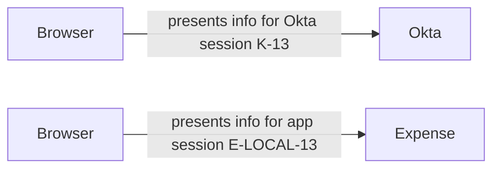

# Day 13: Policies, sessions, and another authentication check

Daniel opens Northbridge Expense from his Okta dashboard and receives another authentication challenge. He asks, “I am already signed in. Why am I being asked again?”

Daniel can see his dashboard, so another prompt feels like the sign-in he already completed is being ignored. Alex needs to separate two questions: is Daniel's Okta session still accepted, and does his authentication evidence satisfy Expense's current requirement? An existing session and an acceptable authentication result for this application are different facts. The challenge could be expected, or it could reveal an incorrect rule or context.

Daniel remains an active Finance manager. His Expense assignment and existing application account are confirmed for this lesson. Missing assignment and missing provisioning are not the demonstrated problems.

First follow a correctly applied rule that requires fresh possession proof. Then compare it with a genuine rule-selection problem. Finally, follow the same browser using separate Okta and Expense sessions, and decide what evidence shows that each one ended. By the end, explain an authentication challenge using the applied rule and current evidence, and verify Okta and application session outcomes separately.

## Give each policy a specific job

Alex starts with what the system is required to check. A **policy** groups requirements. A **rule** states when particular conditions apply and what decision or authentication requirement follows. The policy's job matters: an enrollment requirement, an Okta-session requirement and an application authentication requirement answer different questions.

| Policy or control | Main question |
|---|---|
| Authenticator enrollment policy | Which authenticators may or must this person enroll? |
| Global session policy | What requirements and limits govern the Okta session? |
| Application authentication policy, also called an app sign-in policy | What authentication must satisfy this application's access request? |
| Application's own permissions | What may the person do after entering the application? |

Enrollment is not an accepted challenge response. An app sign-in policy is not the app's expense-approval role. Okta Identity Engine requires the applicable global-session and app authentication requirements to be satisfied; one does not simply cancel the other. See [Okta policies and rules](https://help.okta.com/oie/en-us/content/topics/identity-engine/policies/about-policies.htm).

**Authentication assurance** means the confidence supported by the authentication evidence and its characteristics. A requirement can concern factor types, acceptable methods, or properties such as phishing resistance. Alex compares the evidence with the actual requirement, rather than treating all successful authentication as interchangeable. “MFA happened” is too vague if the current requirement demands something that evidence does not satisfy.

## Keep session lifetime and reauthentication separate

After authentication, a service needs to recognize the person's continuing interaction without starting the same process from the beginning for every request. A **session** lets it do that. In this browser-based example, cookies help the browser present session information to the relevant service. The browser presents information; the receiving service decides whether it still accepts that session. A cookie's presence alone does not prove that the server still accepts it.

The global session policy governs the Okta session, including its maximum lifetime and idle limit. A maximum lifetime limits overall duration; an idle limit concerns inactivity as evaluated by that service. Neither should be assumed to equal the lifetime of an application's own session.

**Reauthentication** is another authentication check required for an access request. The app sign-in policy can require renewed evidence even while an Okta session remains valid. Existing evidence might also be reusable when it satisfies the applicable requirements. The result depends on the actual rule and context, not a universal “one prompt per session” rule. See [global-session rules](https://help.okta.com/oie/en-us/content/topics/identity-engine/policies/add-okta-sign-on-policy-rule.htm) and [app sign-in rules](https://help.okta.com/oie/en-us/content/topics/identity-engine/policies/add-app-sign-on-policy-rule.htm).

Keep two clocks and one access decision distinct: how long the session can last, how inactivity is measured, and whether the current request needs another authentication check. An Okta app sign-in rule acts when the application sign-in flow reaches Okta. It does not mean every click within an already established application session automatically returns to Okta for evaluation.

## Identify the policy that actually applies

An application must be associated with the intended authentication policy. A policy may be shared by multiple applications. Editing a shared rule can therefore affect more than the application named in the ticket.

For the ordered rules used here, Okta checks rule conditions in priority order. The matching rule determines the action; a more restrictive rule placed lower does not automatically win. Conditions may use group membership, device information, or network context. Inspect the values evaluated for this attempt, not just the user's usual location or a policy's descriptive name. See [rule evaluation order](https://help.okta.com/oie/en-us/content/topics/identity-engine/devices/add-app-signon-policy-desktop.htm).

To explain a prompt, Alex needs the selected rule and the conditions that made it apply. A policy name such as “Expense security” cannot provide that evidence. These policy priorities are different from Day 4's profile-source priority. One selects authentication behavior; the other concerns data ownership.

## Follow Daniel's expected challenge

Packet P-1 uses simplified policy intent, not literal Admin Console labels or a complete configuration. Daniel has already completed the required enrollment from Day 7. Expense uses Day 9's confidential OIDC web-client architecture.

| Evidence | Observation |
|---|---|
| Okta session K-13 | Present and valid for Daniel in the checked browser. |
| Expense policy association | The intended Expense authentication policy is assigned. |
| Matched rule E-13 | The configured rule applies to Daniel's observed group and context. |
| Rule requirement | Password plus an allowed possession factor, with separate configured freshness requirements. |
| Evaluation of existing proof | Password evidence remains acceptable; the possession-factor freshness condition is not satisfied. |
| Enrollment | Daniel has an eligible Northbridge Okta Verify enrollment. Push is allowed in this example. |
| Current result | A Push challenge is issued for the Expense sign-in. No accepted response has yet been recorded. |

**Freshness** asks whether previous authentication is recent enough under the applicable rule. This packet explicitly supplies the evaluation result; the reader does not need to calculate an interval or assume that all factors share one interval.

Before calling the prompt a problem, compare the current evidence with the requirement. The password proof is accepted, but the possession proof is not sufficiently fresh. What result should Alex expect at this point?

The challenge is consistent with the stated rule. Daniel's valid Okta session did not make older possession evidence sufficient. His enrollment supplies a possible method, not proof that he completed this challenge. This is renewed proof for the application request, not evidence that his assignment disappeared or that he needs another Expense account.

There is no demonstrated policy defect in P-1. Explain the requirement and investigate the challenge outcome if he cannot complete it: issuance alone does not establish delivery, Daniel's response or acceptance. Removing the requirement just to eliminate a prompt would change the approved access decision rather than explain what happened.

In follow-up P-2, the current Push response is accepted and Okta records that the applicable authentication requirements are satisfied. Expense's backend then completes its OIDC exchange and validation, associates Daniel with his intended account, and establishes application session E-LOCAL-13. A protected page is returned successfully.

Follow P-2 through the boundaries you learned earlier. The current authentication proof is accepted; the backend exchange and validation succeed; Expense selects the intended account and establishes its own session; the protected page actually returns. P-2 demonstrates entry for that attempt. It does not prove that Daniel may approve a particular expense, nor does it prove that an unrelated earlier failed attempt succeeded.

## Contrast a genuine policy-selection problem

Independent packet P-3 changes the policy evidence. The approved design places a restrictive rule for the identified sensitive population before a general rule. The observed configuration instead has a broad matching rule above it. The evaluation record shows that the broad rule matched Daniel and did not require the intended additional proof.

The discrepancy is between the approved rule order and the applied configuration. The general rule is reached first and supplies the decision, so the intended lower rule is not automatically added afterward. Unlike P-1, this packet supplies a demonstrated configuration problem. Inspect the policy's application associations, rule conditions, priority, and affected populations. Propose restoring the approved selection behavior, then verify both a relevant request and a request that should follow a different rule. A test of only Daniel's request would leave the other affected paths unchecked.

Do not diagnose P-1 using P-3's evidence: P-1 correctly selected its rule. Conversely, “Daniel got in” would not prove P-3 meets the intended protection requirement. Success must be judged against the approved behavior.

## Build a correlated evidence trail

The **System Log** records Okta-side events. Its outcome belongs to a particular action. An authentication success, session creation, and app SSO outcome answer different questions.

An **event** is one recorded occurrence. A **transaction** groups events belonging to an operation, such as a request to Okta. A user session can span several operations. Two events may therefore have different event identifiers but the same transaction identifier; later operations may use a different transaction while relating to the same session.

Start with the person, application instance, relevant sequence, and observed behavior. Then connect related records using identifiers where available:

| Field or evidence | Use |
|---|---|
| Actor and target identifiers | Identify who or what acted and which objects were affected. |
| Event type and outcome | Establish the action and its recorded result. |
| Event uuid | Identify an individual event. |
| transaction.id | Relate events within an operation. |
| authenticationContext.externalSessionId | Relate events within an Okta user session. |
| authenticationContext.rootSessionId | Group sessions sharing a common root where that context is available. |
| Application's own evidence | Establish its protocol validation, account association, local session, or permission result. |

Keep the main distinction in view: event UUID identifies one recorded occurrence, transaction ID connects events within an operation, and external session ID connects events within the same Okta user session. Root session ID provides related-session context when available. The names help you choose what to correlate; they do not make every identifier the same thing.

These fields are described in [Okta's System Log correlation guide](https://developer.okta.com/docs/reference/system-log-query/). The name externalSessionId does not make it the application's own session identifier. One browser journey may involve several transactions; some records lack a usable session identifier. Do not force every event into a single transaction or discard a relevant event solely because its session field is absent.

For P-1/P-2, an investigator's synthetic summary is:

```text
Daniel + Expense + Okta session K-13
    operation A: applicable rule; renewed possession evidence required
    operation B: current challenge response accepted
    operation C: Okta-side Expense SSO result
Expense's correlated records
    OIDC exchange and validation accepted
    intended Daniel account selected
    local session E-LOCAL-13 established; protected request accepted
```

Read the summary from the policy decision to the protected request. The Okta records establish its decisions and authentication results. Expense's records establish its exchange, selected account and local-session outcome. No single success in the first group can stand in for all the results in the second.

The labels above are teaching identifiers, not raw Okta event values. The investigator has correlated the operations and application records; their identifiers are not assumed to be identical across systems.

A nearby success for Maya, another app, or an earlier Daniel attempt is not a substitute. Likewise, a search returning no event may reflect incomplete coverage rather than proof that nothing happened. Day 2's evidence boundaries and Day 11's completeness checks still apply.

## Explain why two sessions matter

After P-2, the browser can interact with two services. The two browser labels below represent the same browser making separate requests to Okta and Expense, using each service's session information:



Read the diagram as two destinations for one browser. A request to Okta presents information for K-13; a request to Expense presents information for E-LOCAL-13. Each receiving service checks the session it owns. The repeated Browser label does not introduce a second device or person.

Expense established its own session after validating the sign-in exchange. In this fictional implementation, ordinary protected-page requests are checked against Expense's local session, not sent to Okta for a fresh OIDC exchange every time. That behavior must be established from the application, not assumed for all products.

An ID token is not the same object as that local session. Expiration of an ID token does not by itself demonstrate that the application ended a session it previously created. Similarly, active false in an account-management response is not a session-termination receipt.

Consider packet S-13, after an approved session-ending action for Daniel. His employment and application assignment are unchanged:

1. Okta confirms that K-13 is ended.
2. A subsequent request to Okta cannot reuse K-13 and requires the applicable sign-in process.
3. Expense still accepts a new protected request through E-LOCAL-13.
4. Expense's owner confirms that its local session remains valid and this request did not initiate a new Okta sign-in.

Compare the second and third observations before judging the action. Okta refuses reuse of K-13, while Expense accepts a new protected request through E-LOCAL-13. The owner's evidence rules out a new Okta sign-in as the source of this request. The observations establish different outcomes in the two systems. Ending K-13 worked; it did not end the checked Expense session. This is not evidence that Okta deactivation failed, because no deactivation was performed in S-13.

## Define what signing out must accomplish

**Local logout** ends the application's session under its implementation. It does not automatically establish that Okta or another application's session ended. If an Okta session remains, a later app sign-in may reuse acceptable authentication evidence; a prompt-free return does not necessarily mean the local logout failed.

**Single Logout (SLO)** coordinates logout across participating integrations when supported and configured. Its reach depends on those participants; it is not a universal instruction that ends every application session. Do not infer participation, delivery, or successful termination from the name alone. Ask which sessions an action targets and verify each required outcome. See [Okta's SLO support and configuration boundaries](https://help.okta.com/oie/en-us/content/topics/apps/apps_single_logout.htm).

For S-13, the appropriate next decision depends on the requirement. If only the Okta session needed to end, the supplied Okta evidence supports that outcome. If both Okta and Expense access through the existing sessions needed to end, the Expense owner must complete and verify its supported termination action. A repeat protected request should no longer succeed through the terminated local session; a newly established session must be distinguished from reuse of the old one. The test is about that session's continued authority, not merely whether the browser displays a sign-in prompt.

This also explains the investigation required for Jordan in Day 12. A separate application session is a possible reason access can persist, but Daniel's evidence does not prove Jordan's root cause. Correlate Jordan's actual account and session records, confirm the removal requirement, and verify his outcome independently.

## Predict who a rule change will affect

Before changing an authentication rule, identify the policy, its application associations, rule order, conditions, and required proof. Write down an eligible user, an excluded user, and an existing-session situation. Predict the selected rule and expected challenge for each before evaluating evidence.

A group condition answers who may match; the requirement answers what proof they must provide. Moving a broad rule above a narrower rule can change which requirement is reached. Reducing a freshness requirement changes how recent the accepted proof must be; it does not create missing enrollment or grant an application permission.

For Daniel's P-1, an expected challenge is not a reason to weaken the rule. In P-3, the supplied matching-rule evidence does establish an ordering problem. After an approved correction, inspect fresh attempts from the affected populations and confirm that other applications sharing the policy retain their intended behavior.

Daniel's original question now has two distinct answers to investigate: a valid session can coexist with a requirement for newer proof, and each service has its own session outcome to verify. Use the applied rule to explain the challenge, and the receiving application's evidence to explain continued access. A prompt or a success label alone cannot answer both questions.

Practice selecting evidence and explaining the resulting action in [the report-access request](../requests/department-and-reporting.md) after Day 14.

## Before moving on

Can you explain why P-1 is an expected challenge but P-3 is a demonstrated configuration problem? Can you identify which service owns each session, distinguish an event from a transaction, and state what a successful Okta-side result still leaves for the application to verify?

Try the [exercises](../exercises/day-13.md), then the [answers](../self-checks/day-13.md). In [your notebook](../notebook/guide.md), record the expected requirement, actual matched rule, authentication evidence, Okta-session result, and separate application result.

[Day 14](day-14-requirements-and-responsibilities.md) turns business requests into clear access requirements and administrative responsibilities.

For more examples, open the [Day 13 practice bank](../question-bank/day-13.md). Each question includes its own context and an expandable teaching explanation.

[Previous: Day 12](day-12-joiners-movers-leavers.md) · [Course home](../index.md)

[Revise Day 13](../revision/day-13.md): revisit the concepts, example, and questions without rereading the full lesson.
