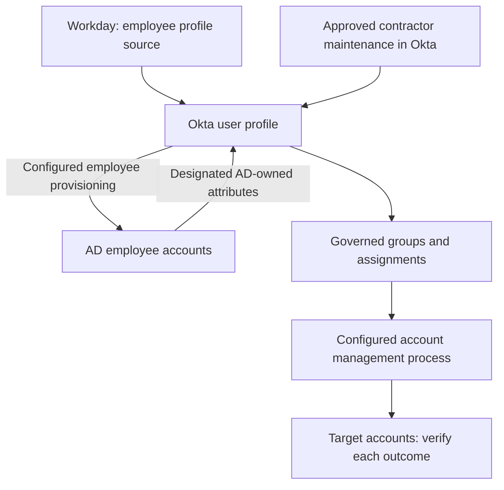
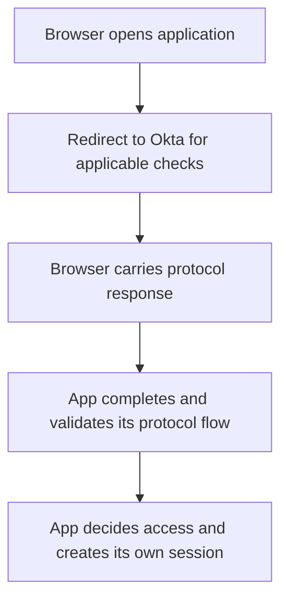

# Okta at a glance

Before you start the daily lessons, picture a person trying to do their work. The company needs to know who they are, which applications they should receive, how they prove their identity, and what they may do after entering an application. Those questions belong to connected systems with different responsibilities.

Use this page as a map. You do not need to memorize the terms before Day 1. Return to it when a detailed example makes you lose sight of the larger journey.

In Northbridge's workforce environment, Okta connects the systems that hold identity information with the applications people need. It holds user profiles, maintains access relationships, performs the applicable sign-in checks, and uses configured connections for account management. The other systems still have their own jobs: HR supplies employment information, and each application must establish its account, access and permission outcomes.

## How identity data flows

At Northbridge, Workday is the profile source for employees such as Maya and Daniel. Okta provisions their AD accounts through the configured employee process; AD returns designated directory-owned values such as work email. Priya is an Okta-managed contractor, maintained after sponsor approval and outside employee import scope. A sponsor approves the change; the sponsor is not another technical source integration.

Read the diagram from the people records toward the target accounts. The employee and contractor paths both reach Okta, but their data is maintained through different processes. The return arrow from AD concerns designated attributes; it does not make AD the owner of every employee field. Follow the direction and purpose of an arrow before assuming what it changed.

Workday is first and AD second in external profile-source priority. That order applies to a user's actual source associations, not to every user merely because both integrations exist. A separately scoped AD-led example teaches users whose profile source is AD; it does not change Maya's Workday-led model. [Day 4](lessons/day-04-sources-and-ownership.md) explains source priority and attribute ownership.

Group rules are one way to maintain membership. Approved group or direct assignments establish intended application access. A supported, configured provisioning process can then manage the target account; otherwise another accountable process must do so. Assignment alone does not prove account creation.

The arrows show relationships to investigate, not one universal order followed by every connector. A correct source value, a group membership, an assignment and a checked target account are separate results. A person can have an Okta profile and still have no account in Salesforce. Ask which result the evidence actually establishes.

## How sign-in works

In these app-initiated examples, the browser travels to Okta for the applicable sign-in checks. With SAML, it carries the response back to the application. In the OIDC code flow taught here, it carries a code; the application backend exchanges that code for tokens. The app validates the relevant messages, identifies the user and decides whether to establish its own session. Receiving a response alone does not establish trust or successful access.

Signing in and having an account are two different things. Signing in and being allowed to do a particular action inside the app are also two different things.

For example, reaching Expense does not by itself establish permission to approve an expense. The application can also maintain its own session after sign-in, so an Okta-session result does not supply every application-session result. Later lessons follow these boundaries separately; for now, keep the receiving system in view.

## The pieces, one line each

| Piece | What it does |
|---|---|
| Universal Directory | Where Okta stores each person's profile and attributes. |
| Profile | The set of details Okta holds about one person. |
| Profile source | The system allowed to control a person's profile. |
| Group | A collection of users. |
| Group rule | A rule that puts people in a group based on their attributes. |
| Application assignment | A record that a user should get an application. |
| Provisioning | Creating, updating, or disabling the account inside the target app. |
| Authentication | Checking who is signing in. |
| Authorization | Deciding what the signed-in user is allowed to do. |
| Policy | The rules that decide what a sign-in requires. |
| System Log | Okta's record of what happened, which you read as evidence. |

These short descriptions are orientation. The lessons explain the conditions and scope behind them: which source applies to a person, which rule or policy was evaluated, and which target result was confirmed. A product label alone is not an explanation of a ticket.

## The one habit to carry everywhere

When something does not work, do not guess. Ask four questions:

1. What should have happened for this person and this app?
2. What actually happened?
3. Where did those two first differ?
4. What evidence proves it?

Use the answers to choose a justified next check. If the packet does not establish a cause or approval, record the missing evidence rather than filling the gap with a familiar explanation. After a correction, check the required outcome in the affected system before reporting success.

Ready? Start with [Day 1](lessons/day-01-people-identities-access.md) and follow the [learning path](learning-path.md) in order. When a flow gets confusing, come back to this page.
